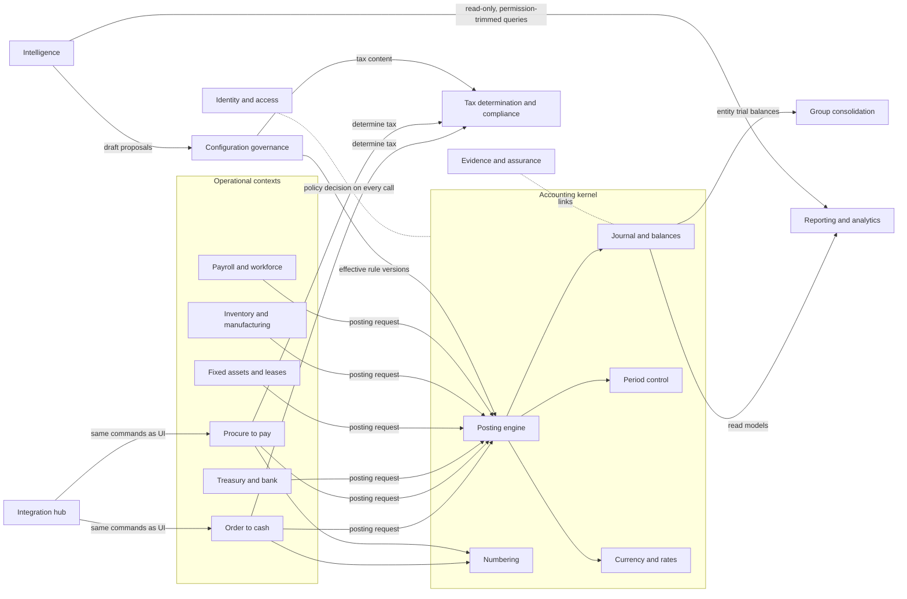
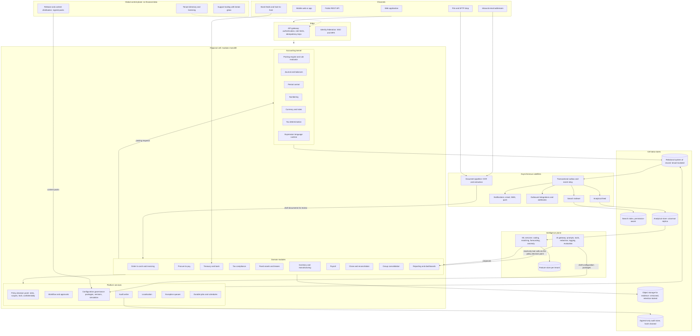
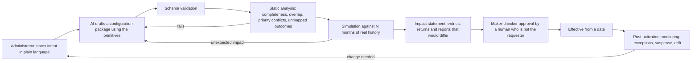

# TIQACC: Strategic Architecture Discovery and Requirements Analysis

| | |
|---|---|
| **Document** | Architecture discovery, stage 1 of 2 |
| **Source analysed** | `requirement-doc/TIQACC-Cloud-Accounting-Requirement - V1.pdf` (121 pages, sections 1 to 3) |
| **Date** | 19 October 2026 |
| **Status** | Draft for stakeholder review |
| **Next stage** | Prompt 2: architecture deep-dive (resolves the design questions in section 16) |

> **Reading convention.** Statements are tagged where it matters:
> **[FACT]** is stated in the specification, with its clause reference.
> **[ASSUMPTION]** is inferred by this analysis and must be confirmed.
> **[RECOMMENDATION]** is this analysis's proposal.
> Clause references such as 2.6.10 point to the specification.

---

## 1. Executive summary

**What the specification asks for.** TIQACC is specified as a cloud, multi-entity, multi-jurisdiction, multi-currency, multi-language financial management system with fourteen modules: general ledger, receivables, tax and non-tax invoicing, payables, bank and treasury, tax compliance, fixed assets and leases, inventory with manufacturing, payroll for any country, supporting evidence, balance sheet reconciliation, reporting, group consolidation, and a CFO dashboard. It also requires that each module can be activated per entity and sold standalone. [FACT, 1, 2.1.7]

**What kind of system this really is.** Read as a whole, the specification is not a bookkeeping product. It is a *controls-first record-keeping system*. Its recurring demands are the same seven ideas, repeated in every module:

1. Every figure is produced by the system from a source transaction through a configurable rule. No user keys a journal the system could raise. [FACT, 2.2.4, 2.6.10]
2. Approval is the boundary. Before it, data is editable. After it, nothing changes and corrections are new entries. [FACT, 2.2.6]
3. Everything that shapes a figure is effective-dated configuration, never code: posting rules, tax rates, payroll law, depreciation policy, numbering, mappings, workflows. [FACT, 2.1.7, 2.7.1, 2.10.2]
4. Every figure drills to its source document and evidence, in both directions. [FACT, 2.2.4, 2.11, 2.15.10]
5. Every change to structure or configuration is attributed, approved and shown to management without being asked for. [FACT, 2.15.8]
6. Every read channel, including search, reports, exports, the API and AI assistants, respects the same permissions. [FACT, 2.1.5, 2.13.2, 2.1.9]
7. AI assistants read and propose. They never post, approve, release or change configuration. [FACT, 2.1.9]

**Scale of the undertaking.** The functional scope is comparable to established mid-market ERP suites. Payroll "for any country by configuration" and manufacturing with MRP are each products in their own right. Building every module to the depth specified is a multi-year programme. The specification says every module is to be built, so the phasing below sequences that scope rather than cutting it. [FACT, 1 "Module activation"]

**Recommended direction.** [RECOMMENDATION]

- **A modular monolith around a protected, deterministic accounting kernel**, on a relational system of record, deployed in regional cells. Approval, numbering, posting, sub-ledger update and audit must commit atomically. A single ACID transaction does that simply. Distributed services would turn it into a saga problem with no business benefit at the stated scale.
- **A governed configuration plane** as the main extensibility mechanism. Every artefact that shapes a figure is a versioned, effective-dated package with a lifecycle of draft, validated, simulated, approved and effective. One deterministic expression language serves posting rules, tax rules, payroll formulas, custom depreciation methods and report calculations.
- **AI as an author and analyst, never as an actor on the books.** AI drafts configuration, extracts documents, suggests coding and matches, compiles plain-language requests into inspectable report definitions, and narrates computed decompositions. The kernel, simulation and a human approver decide what takes effect.
- **CQRS only where it pays.** Balance projections are maintained synchronously inside the posting transaction. Search, analytics, ML and notifications use asynchronous read models fed by a transactional outbox. The journal is append-only by nature, which gives the ledger the benefits of event sourcing without adopting event sourcing for every aggregate.

**Where differentiation is credible.** Bank feeds, rule-based coding, invoice OCR, AI reconciliation suggestions, natural-language questions and multi-entity consolidation already exist in the market (section 5). Defensible differentiation is more likely in four places:

- an evidence-carrying, continuously self-verifying ledger;
- governed AI-assisted configuration with impact simulation against real history;
- deterministic natural-language reporting;
- depth of compliance content for under-served jurisdictions such as Sri Lanka and the GCC. This last one is a market position, not a technology.

**Biggest open questions.** Whether TIQACC is a bespoke build for one group or a multi-customer SaaS product. All bracketed values, including volumes, entity counts and user counts. The accounting framework (IFRS, SLFRS or other). Data protection obligations. Which jurisdictions launch first. Section 3 lists them in full.

---

## 2. Requirements analysis and traceability matrix

### 2.1 Nature of the source document

- **[FACT]** The document is written as a buyer's specification. It refers to "vendors", an Annexure A response matrix (S/C/X/N per clause), an acceptance protocol, and sign-off by Finance, Internal Audit and the Managing Director. Annexures A and B are not included in the supplied PDF.
- **[FACT]** It contains roughly a thousand individually testable clauses and about two hundred acceptance tests across sixteen sub-sections.
- **[FACT]** Square brackets mark values the entity must confirm before issue, such as `[7] years`, `[role]`, `[No.] legal entities` and `[X] transactions per month`. None is confirmed in this version.
- **[ASSUMPTION]** Location and tax references point to an anchor group headquartered in Sri Lanka, with operations or ambitions in the UAE, France, Portugal and China. Evidence: Colombo, Dubai, Paris, Lisbon and Shanghai in 2.1.8; SSCL, EPF and ETF in 2.7. This affects which compliance content is built first.
- **[ASSUMPTION]** The team building TIQACC intends it as a product for many customers, with this group as anchor customer. Evidence: industry templates for twelve sectors, standalone module licensing, "vendors state which modules are available today". If the intent is a single bespoke build, several recommendations below simplify. See question Q1.

### 2.2 Requirement identifiers

Requirements are grouped by capability. Each identifier maps to the clause that states it. Type is **F** functional, **N** non-functional, **C** constraint or invariant. Phase refers to section 13. The matrix covers requirements with architectural consequence. A full clause-level matrix, generated from the specification, is recommended as an engineering artefact for the next stage.

#### Platform, access and security

| ID | Requirement | Source | Type | Architectural consequence | Phase |
|---|---|---|---|---|---|
| PLT-01 | Browser-based cloud system, multi- or single-tenant, on-premise quoted as alternative | 2.1.1.1, 1 | N | Tenancy model must support pooled and dedicated deployment from one codebase. On-premise multiplies operational cost and should be challenged | 0 |
| PLT-02 | Production, sandbox refreshed from production, and training environments | 2.1.1.2 | N | Tenant-level copy and refresh tooling. Production copies contain payroll data, so masking is needed (missing requirement M-14) | 1 |
| PLT-03 | Mobile approvals, photo capture, dashboard viewing | 2.1.1.3 | F | API-first design. Responsive web or PWA before native apps | 2 |
| PLT-04 | Dropped connection must never create a partial or duplicate transaction | 2.1.1.4 | C | Idempotency keys on every state-changing command, from UI and API alike | 0 |
| PLT-05 | Unsaved work recoverable after session timeout | 2.1.1.5 | F | Server-side draft persistence | 1 |
| PLT-06 | Roles built by the entity from module, object and action permissions, scoped by entity, location, department, cost centre, project, bank account and document type, with value bands, explicit deny, per-entity assignment, effective dating and delegation | 2.1.2 | F | Central attribute-based authorisation engine, evaluated identically on every channel. Not achievable with role checks scattered through code | 0 |
| PLT-07 | Configurable segregation-of-duties matrix with warn or block, documented exceptions with expiry, conflict report | 2.1.2 | F | SoD checked at role assignment and at transaction time. Exceptions are first-class records that tag every transaction processed under them | 0 |
| PLT-08 | No self-approval and no audit-log change, regardless of configuration | 2.1.2.5 | C | Kernel invariants, outside the configuration plane | 0 |
| PLT-09 | SSO, MFA off-network, configurable password policy, encryption at rest and in transit, data residency per jurisdiction | 2.1.3 | N | Federated identity. Regional deployment cells. Residency conflicts with "one data set" for groups spanning residency-bound countries (see R-06) | 0 |
| PLT-10 | Immutable audit log of every create, amend, delete, approve, reject, cancel, export and login, with field-level before and after values, source channel, seven-year retention | 2.1.4 | C | Append-only, tamper-evident audit store written in the same transaction as the change. High volume. Must also cover reads of payroll records (2.10.14) | 0 |
| PLT-11 | One search box across all records and attachment text, permission-trimmed, number normalisation, results in [3] seconds over full history | 2.1.5 | F/N | Dedicated search index with document-level security, OCR pipeline, near-real-time indexing from the outbox | 1 |
| PLT-12 | Versioned REST API equal to what the screens use, web services, file import and export, stable read views, scheduled and event-driven sync | 2.1.6 | F | API-first. UI is a client of the public API. Published reporting views decoupled from physical tables | 0 |
| PLT-13 | Interfaces configured not coded: mapping, value translation, schedule, error handling | 2.1.6.3 | F | Integration hub with mapping definitions in the configuration plane | 2 |
| PLT-14 | Inbound messages validated like manual entry, all-or-nothing batches, idempotent on source reference, exception queue, interface reconciliation of counts and totals, alerting | 2.1.6 | C | Inbound staging area, idempotency ledger, per-interface control totals | 1 |
| PLT-15 | System of record declared per record type and per field; dual-authorisation records arrive as pending | 2.1.6 | F | Field-level ownership metadata on master data | 2 |
| PLT-16 | Modules activated per entity from an effective date, absent when off, no migration when activated later | 2.1.7 | F | Activation is effective-dated entity configuration consulted by UI, API, search, reports and posting. Shared master data from day one | 0 |
| PLT-17 | Each module sellable standalone, posting to the customer's own ledger by file or API, reconciling its sub-ledger to that ledger | 2.1.7 | F | A ledger port: the posting engine writes to the internal ledger or to an external-ledger adapter. Platform services are not module-specific | 3 |
| PLT-18 | Industry templates, versioned, applied as a reviewed change and never an overwrite | 2.1.7 | F | Configuration packages with diff, merge and impact preview | 2 |
| PLT-19 | Business profile (inventory, service, mixed) decides which document stages and postings exist | 2.1.7 | F | Process variants are configuration of one flow, not forks | 1 |
| PLT-20 | Language per group, country, entity and user. Translated UI, documents, master data, terminology as data, RTL layout, fallback with reporting | 2.1.8 | F | Translatable-field model for master data, resource service for UI text, document rendering per recipient language with the issued version retained | 1 (model), 2 (RTL) |
| PLT-21 | Assistant rules: read-only, traceable, no unevidenced causes, estimates labelled, commentary reviewed, permission-bound, logged, switchable per entity | 2.1.9 | C | AI gateway with read-only, permission-trimmed tools and provenance capture (section 12.5) | 1 |
| PLT-22 | Configurable number formats; separate sequences per entity, location, module and type; gapless statutory series; consecutive under concurrency; authority-issued ranges; gap report | 2.1.10 | C | Numbering service inside the kernel, allocated in the issuing transaction | 0 |

#### General ledger and core accounting

| ID | Requirement | Source | Type | Architectural consequence | Phase |
|---|---|---|---|---|---|
| GL-01 | Fixed six-digit numeric codes, class from first digit, up to four group levels, control-account flag, statement and note mapping, cash-flow class, per-dimension rules, currency restriction, effective-dated structure | 2.2.1 | F | Chart of accounts as effective-dated hierarchy. Reports resolve structure "as at" the period reported | 1 |
| GL-02 | Accounts created only through a request with duplicate check, maker-checker and proposed code | 2.2.2 | F | Governed master-data workflow. Similarity search over names and purposes | 1 |
| GL-03 | Six standard dimensions plus at least four entity-defined, on every line of every module, rules per account, values restricted per entity, defaults from masters | 2.2.3 | F | The dimension storage model drives query performance and flexibility. A key deep-dive topic | 0 |
| GL-04 | Every module posts automatically at approval. A transaction that cannot produce a complete balanced entry is refused at source | 2.2.4.1 | C | Posting is synchronous and inside the approval transaction | 0 |
| GL-05 | Pre-posting validation report; missing account mapping raised at set-up, not month end | 2.2.4.3, 2.6.10.4 | F | Static completeness check of posting rules against all transaction-type combinations | 1 |
| GL-06 | Bulk journal upload: full validation, all-or-nothing, same approval route, batch reversal | 2.2.4 | F | Staged import with transactional commit | 1 |
| GL-07 | Traceability both ways from statement line to evidence in four steps, preserved in exports | 2.2.4, 2.2.10.4 | F | Link model from statement line through account, entry, document, line and attachment | 1 |
| GL-08 | Ten journal types with distinct approval rules | 2.2.5 | F | Journal type is configuration over one journal engine | 1 |
| GL-09 | Approval boundary: drafts editable without approval; approver amendments recorded and bounded by threshold; posted entries locked against every channel including administrators | 2.2.6 | C | Document state machine plus database-level immutability for posted data | 0 |
| GL-10 | Prepayment, deferral and accrual schedules; exact totals; revision without altering posted lines; system-generated reversals | 2.2.7 | F | Schedule engine plus durable scheduler | 1 |
| GL-11 | Period states per module and entity (open, soft closed, hard closed, audit locked), adjustment and audit periods, override route, year-end in draft then committed, close checklist gating | 2.2.8 | C | Period control in the kernel, checked by every posting path including scheduled jobs and imports | 1 |
| GL-12 | ISO 4217 currencies, minor-unit precision, preferred and manual rate sources with recorded fallback, five rate types, rate history never overwritten, period rate locks, transaction, functional and reporting amounts stored, realised and unrealised differences, revaluation with reversal | 2.2.9 | F/C | Currency and rate service in the kernel. Three amounts persisted per line | 1 |
| GL-13 | Statutory statements, budgets with versions, budget versus actual | 2.2.10 | F | Statement layouts as configuration over mapping | 1 |

#### Receivables and invoicing

| ID | Requirement | Source | Type | Architectural consequence | Phase |
|---|---|---|---|---|---|
| AR-01 | Customer master held once for the group, terms and tax per entity, unlimited hierarchy, second authoriser for creation and sensitive changes | 2.3.1 | F | Group-shared master with entity-specific facets. Dual-control pattern for master data | 1 |
| AR-02 | Order-to-cash documents and states; delivery stage only when inventory active | 2.3.2 | F | Configurable document flow | 1 (service), 3 (with stock) |
| AR-03 | Standard, proforma, recurring, milestone, progress with retention, subscription, project and intercompany billing | 2.3.3 | F | Billing plans as a generic schedule capability | 1 to 2 |
| AR-04 | Revenue on issue, deferred, accrued, percentage of completion, milestone, subscription; billing and recognition as separate events | 2.3.4 | F | Revenue schedule engine shared with GL-10 | 2 |
| AR-05 | Live credit exposure including unbilled and undelivered; rules engine with warn or block; temporary limits that expire; hold escalation | 2.3.5 | F | Exposure as a maintained projection, not a query over all history | 1 |
| AR-06 | Receipts of all types; never posted without a customer; suspense otherwise | 2.3.6 | F | | 1 |
| AR-07 | Proposed allocation from remittance and reference, configurable rules, many-to-many settlement, small-difference write-off only with approval, derived invoice state | 2.3.7 | F | Allocation engine. Invoice state is computed, not stored by users | 1 |
| AR-08 | Live ageing at any back-dated cut-off that agrees to the control account | 2.3.8 | F/C | Requires as-at reconstruction of open items | 1 |
| AR-09 | Collection profiles, reminders, promises to pay, disputes | 2.3.9 | F | Workflow plus notification channels | 2 |
| AR-10 | Expected credit loss matrix with visible workings, posted only on approval | 2.3.10 | F | Calculation runs that persist their workings (2.11.5) | 2 |
| IVC-01 | Document type determined by item tax class, customer status and place of supply, configurable per jurisdiction, automatic split per treatment where required | 2.4.2 | F | Tax determination engine shared with 2.7 | 1 |
| IVC-02 | Statutory content and versioned templates per entity, location and country; version used retained with the document | 2.4.3 | F | Document rendering service with template versioning | 1 |
| IVC-03 | Sending from entity address with SPF, DKIM and DMARC; delivery tracking; bounce exceptions; batch send | 2.4.5 | F | Outbound mail service with per-tenant sender domains | 1 |
| IVC-04 | Issued invoices never edited; credit notes capped at the original value; e-filing and e-invoicing formats per jurisdiction | 2.4.6, 2.4.7 | C | Jurisdiction adapters for e-invoicing (see section 5.3 on UAE and Sri Lanka mandates) | 1 to 2 |

#### Payables

| ID | Requirement | Source | Type | Architectural consequence | Phase |
|---|---|---|---|---|---|
| AP-01 | Supplier master with dual authorisation; bank detail change needs two approvers plus call-back | 2.5.1, 2.5.17 | C | Same dual-control pattern as AR-01 | 1 |
| AP-02 | Duplicate detection on every capture route | 2.5.2 | F | Deterministic keys plus fuzzy near-match | 1 |
| AP-03 | Inbound email capture: split multiple invoices, sender control, field extraction, supplier and order matching, side-by-side review, per-supplier learning, nothing posts without review | 2.5.3 | F | Document AI pipeline. Inbound email is untrusted input (see R-09) | 1 |
| AP-04 | Approval matrix by value, entity, unit, department, cost centre, supplier category and risk | 2.5.5 | F | Generic approval engine | 1 |
| AP-05 | Two-, three- and four-way matching with tolerances; exceptions resolved, not approved around | 2.5.6 | F | Match engine and exception work lists | 1 (2-way), 3 (3/4-way) |
| AP-06 | Advances, retentions and their set-off with confirmation | 2.5.8 | F | | 2 |
| AP-07 | Payment runs with proposals, exclusion reasons, withholding at payment, bank file formats configurable without development, separate release permission, cooling-off on changed bank accounts | 2.5.9 | F/C | Bank file format definitions as configuration | 1 |

#### Bank, cash and the posting rules engine

| ID | Requirement | Source | Type | Architectural consequence | Phase |
|---|---|---|---|---|---|
| BNK-01 | Bank account types, signatories and limits, encrypted credentials never displayed to anyone | 2.6.1 | C | Secrets vault. Credentials never held in clear in the application database | 1 |
| BNK-02 | Open banking, host-to-host, SFTP, MT940, CAMT.053 and .054, BAI2, CSV, Excel; duplicate-proof re-import; balance continuity checks | 2.6.3 | F | Statement ingestion with format adapters and line hashing | 1 |
| BNK-03 | PDF and scanned statement upload with column mapping templates and per-line confidence | 2.6.4 | F | Document AI for tables across page breaks | 1 |
| BNK-04 | Coding suggestions with reasons; rule created from a confirmed line; rules tested against history before activation | 2.6.5 | F | Rules first, learned suggestions second (section 10) | 1 |
| BNK-05 | One-to-one, one-to-many and many-to-one matching; eight line classifications; reconciliation states with preparer and reviewer | 2.6.6 | F | Match engine with candidate generation | 1 |
| BNK-06 | Treasury instruments, pooling, facilities, liquidity position | 2.6.7 | F | | 3 |
| BNK-07 | Cash forecast from all modules with scenarios and forecast-versus-actual | 2.6.8 | F | Read model across modules | 2 |
| BNK-08 | **One posting rules engine for every module**, configured by the entity, versioned and effective-dated, explicit priority, testable against history, dimension inheritance declared, rule and version stamped on every entry | 2.6.10 | C | The heart of the kernel (sections 8.2 and 9) | 0 |
| BNK-09 | Validation catalogue; typed exception queue; suspense only for unidentifiable items, nil before close | 2.6.11 | C | Exception queue is a platform capability used by every module | 1 |
| BNK-10 | Scheduled period-end runs with preview, optional approval, failure alerting | 2.6.12 | F | Durable job orchestration with run records | 1 |

#### Tax

| ID | Requirement | Source | Type | Architectural consequence | Phase |
|---|---|---|---|---|---|
| TAX-01 | Tax register: any tax, jurisdiction, basis, dated rate series, status, filing frequency, due-date rules with holidays, rounding, return format | 2.7.1 | F | Tax content as versioned data packages per jurisdiction | 1 |
| TAX-02 | Narrowest rule wins across country, entity, region, transaction type, product, item, customer and supplier class, place of supply; deciding rule recorded | 2.7.1 | C | Same rule-resolution semantics as posting rules | 1 |
| TAX-03 | Entity tax profile proposed from jurisdiction and industry; exemptions with certificates and expiry | 2.7.2 | F | | 1 |
| TAX-04 | Tax computed wherever it arises, never keyed; recoverability and apportionment; reverse charge; withholding; turnover levies | 2.7.3 | F | | 1 |
| TAX-05 | Return workspace populated from the ledger box by box, drill-down, identified adjustments, variance checks, three-person workflow, locked when filed, amended returns as versions | 2.7.4, 2.7.8 | F/C | Return mappings as configuration; filed returns as immutable snapshots | 1 |
| TAX-06 | Corporate income tax: account tags, capital allowance register, losses, deferred tax, instalments, effective rate reconciliation | 2.7.6 | F | | 3 |
| TAX-07 | Compliance calendar and evidence gating (acknowledgement before "filed", payment proof before "paid") | 2.7.7 | F | | 2 |

#### Fixed assets, inventory and payroll

| ID | Requirement | Source | Type | Architectural consequence | Phase |
|---|---|---|---|---|---|
| FA-01 | Register with components, custodians, effective-dated locations and dimensions | 2.8.1 | F | | 2 |
| FA-02 | Three inputs at capitalisation; policy from category with narrowest-level override; full schedule landing exactly on residual | 2.8.3 | F/C | Deterministic schedule calculator with rounding policy | 2 |
| FA-03 | Six methods including an entity-defined formula added without development | 2.8.3 | F | Needs the shared expression language | 2 |
| FA-04 | Multiple books per asset; only configured books post | 2.8.4 | F | | 2 |
| FA-05 | Revaluation, impairment and capped reversal; IFRS 16 right-of-use and lease liability with remeasurement | 2.8.7, 2.8.8 | F | | 2 |
| STK-01 | Item master shared across group; balances per entity and warehouse down to bin; virtual and transit warehouses; negative stock blocked | 2.9.1, 2.9.2 | F/C | Concurrency control on stock balances | 3 |
| STK-02 | Batch, serial, expiry, two-way trace, recall in one action | 2.9.4 | F | | 3 |
| STK-03 | FIFO, weighted average, standard, specific identification; landed cost applied retrospectively split between stock and cost of sales; valuation as at any past date | 2.9.7 | F/C | Cost layer model. Costing correctness is a kernel-adjacent concern | 3 |
| STK-04 | Stock quantity and value as one record, ledger agreement continuous | 2.9 intro, 2.9.12 | C | Stock movement and its posting commit together | 3 |
| STK-05 | BOM, production orders, WIP, variances, MRP suggestions | 2.9.8 | F | A product in its own right | 4 |
| PAY-01 | Native payroll; a file-synchronised third-party payroll is not acceptable | 2.10 intro | C | Payroll is in scope for the platform, not an integration | 3 |
| PAY-02 | Any country by configuration: tax bands, schemes, contribution bases, labour rules, leave, minimum wage, gratuity; versioned and effective-dated; previewable against current version | 2.10.2, 2.10.3 | F | Payroll rule DSL on the shared expression language, plus country content packs | 3 |
| PAY-03 | Retroactive recalculation on rules in force at the time, arrears itemised; locked runs reproducible years later | 2.10.7, 2.10.8 | C | Rule-set version pinned to each run | 3 |
| PAY-04 | Individual pay visible only to named users, read access logged, assistant bound by the same rules | 2.10.14 | C | Field-level and row-level security plus read auditing | 3 |

#### Evidence, close, reporting, group and executive

| ID | Requirement | Source | Type | Architectural consequence | Phase |
|---|---|---|---|---|---|
| DOC-01 | Attachments on masters, headers, lines, approval steps, journals, reconciliations | 2.11.1 | F | Evidence store with typed links | 1 |
| DOC-02 | Capture by drag and drop, module email address, mobile photo, OCR, API | 2.11.2 | F | | 1 |
| DOC-03 | Configurable mandatory-evidence rules that block | 2.11.3 | F | Evidence rules in the configuration plane | 1 |
| DOC-04 | Versioning, no deletion once posted, retention per entity and jurisdiction, residency | 2.11.4 | C | WORM-capable object storage per region | 1 |
| DOC-05 | Auditor role; audit pack and bulk evidence download of any size in the background | 2.11.6 | F | Asynchronous export jobs | 2 |
| REC-01 | Continuous automatic agreement of control accounts to sub-ledgers | 2.12.1 | C | Invariant checks maintained by the kernel, not reports run at close | 1 |
| REC-02 | Reconciliation records auto-created, preparer and reviewer, late postings revert status, close gating | 2.12.2 to 2.12.4 | F | | 1 |
| RPT-01 | Standard library of statements and operational reports | 2.13.1 | F | | 1 |
| RPT-02 | Report builder over the business data model, saved as definitions, versioned, shareable, row-level security on output | 2.13.2 | F | Semantic layer with security trimming | 2 |
| RPT-03 | Report creation by written instruction, compiled into an ordinary definition, states its interpretation, asks when ambiguous, never produces figures itself | 2.13.3 | F/C | LLM-to-definition compiler (section 10) | 2 |
| RPT-04 | Exports, schedules, packs, reproducible from logged parameters | 2.13.5 | F | Reproducibility requires as-at reads of data and configuration | 2 |
| GRP-01 | Effective-dated group structure with ownership, voting rights, control conclusion, method, sub-groups | 2.14.1 | F | Bitemporal structure model | 2 |
| GRP-02 | Group chart and versioned local-to-group mapping; unmapped balance blocks consolidation | 2.14.3 | C | | 2 |
| GRP-03 | Intercompany documents mirrored automatically with shared reference; each side's tax determined independently | 2.14.4, 2.7.3 | F | Cross-entity transaction pattern inside one tenant | 2 |
| GRP-04 | Eliminations, NCI, goodwill, equity method, translation, consolidation ledger separate from entity books, stale-run detection, locked approved runs | 2.14.6 to 2.14.9 | C | Consolidation as immutable runs over entity snapshots | 2 |
| GRP-05 | Group budgets, versions, scenarios, what-if that never posts | 2.14.11 | F | Planning store separate from the ledger | 3 |
| CFO-01 | Executive dashboard with no stored figures; each tile is a report definition reading live data | 2.15.1 | C | Shares the reporting engine. No separate cube of truth | 2 |
| CFO-02 | Governance and configuration control panel fed by the audit log | 2.15.8 | F | Audit log must be queryable by change category | 2 |
| CFO-03 | Configurable alerts that never block; executive questions answered by decomposition with drill-down | 2.15.9 | F | Deterministic variance decomposition plus LLM narration | 2 |

#### Non-functional

| ID | Requirement | Source | Type | Architectural consequence | Phase |
|---|---|---|---|---|---|
| NFR-01 | Screen response under [3] seconds at [Y] concurrent users | 2.16.1 | N | Unquantified load. See assumption A-03 | 0 |
| NFR-02 | [X] transactions per month without degradation | 2.16.1 | N | Unquantified. Drives ledger and balance design | 0 |
| NFR-03 | [99.5]% monthly availability excluding maintenance windows | 2.16.1 | N | Modest. Single-region active-passive is enough | 0 |
| NFR-04 | Daily backup, RPO [4] hours, RTO [8] hours, restore tested annually | 2.16.1 | N | Modest. Continuous log archiving gives a far better RPO cheaply | 0 |
| NFR-05 | Statutory tax and payroll updates for every configured country at no extra charge | 2.16.1 | N | A permanent compliance content operation, not a software feature (R-04) | 1 |
| NFR-06 | Migration of masters, open items, stock, assets, payroll YTD and [n] years of history, each load reconciled and signed | 2.16.2 | F | Migration toolkit reusing the import and validation pipeline. Migrated documents keep original numbers | 1 |
| NFR-07 | Acceptance per module, one full cycle in parallel run | 2.16.4 | N | Parallel-run reconciliation tooling | 1 |

### 2.3 Architectural drivers

The requirements above collapse into twelve drivers. These, not the module list, should shape the architecture.

| Driver | Statement | Main sources |
|---|---|---|
| **AD-1 Atomic financial integrity** | Approval, numbering, posting, sub-ledger update, balance maintenance and audit commit together or not at all | 2.2.4, 2.1.10, 2.9.12, 2.12.1 |
| **AD-2 Immutability with traceable correction** | Posted data never changes through any channel; corrections are linked new records | 2.2.6, 2.4.6, 2.10.8 |
| **AD-3 Behaviour as governed configuration** | Rules that shape figures are data: versioned, effective-dated, maker-checker, testable, reported | 2.1.7, 2.6.10, 2.7.1, 2.10.2, 2.15.8 |
| **AD-4 Reproducibility as at any date** | Any past report, payslip, return or consolidation reproduces exactly with the structure, rules and rates then in force | 2.2.1.5, 2.2.9, 2.10.15.13, 2.14.9.9 |
| **AD-5 Uniform authorisation on every channel** | Screens, API, search, reports, exports, dashboards and assistants return only what the user may see | 2.1.5.4, 2.13.2.7, 2.14.14.13, 2.1.9.6 |
| **AD-6 End-to-end evidence and drill-down** | Every figure links to entry, document, evidence and audit trail in both directions | 2.2.4, 2.11, 2.15.10 |
| **AD-7 Entity-scoped activation and variation** | Modules, profiles, workflows, tax and currency vary per entity in one deployment | 2.1.7, 2.14.2 |
| **AD-8 Multi-jurisdiction compliance content** | Tax, payroll, e-invoicing, numbering, language and holidays per country as maintained content | 2.7, 2.10, 2.4, 2.1.8 |
| **AD-9 Integration parity** | Anything a user can do, an integration can do under the same controls; inbound data is never a route around a control | 2.1.6 |
| **AD-10 Governed intelligence** | AI and analytics propose; humans and deterministic code decide | 2.1.9 and every module assistant |
| **AD-11 Data residency and isolation** | Tenant isolation, entity isolation within a tenant, and regional storage where law requires | 2.1.3.4, 2.11.4.6 |
| **AD-12 Modest availability, unknown volume** | 99.5% and RPO 4h are mid-market targets; volumes are unstated | 2.16.1 |

---

## 3. Gaps, inconsistencies, assumptions and stakeholder questions

### 3.1 Inconsistencies and ambiguities in the specification

| ID | Finding | Clauses | Why it matters | Proposed resolution |
|---|---|---|---|---|
| D-01 | Two chart-of-accounts models are described. One is a single group chart with entity extension accounts. The other is independent local charts mapped many-to-one, or one-to-many with a split, to a group chart | 2.2.1.3, 2.1.7 entity table, 2.14.3 | Changes the ledger data model and consolidation mapping | Support both: a group chart as the default, plus local statutory charts where a jurisdiction prescribes one. Decide in Prompt 2 |
| D-02 | The fixed six-digit numeric chart with classes 1 to 5 can conflict with prescribed national charts. France's Plan Comptable Général, for example, uses a different class structure | 2.2.1 and the Paris example in 2.1.8 | A French entity may need its statutory chart and statutory exports | Treat the group chart as the management view and allow a jurisdiction-prescribed local chart. Confirm with local advisors |
| D-03 | Posted entries are locked against changes to dimensions, yet the entity may allow post-approval dimension changes | 2.2.6 "After approval" 1 and 5 | A dimension change alters management reporting, so it is not cosmetic | Allow annotation changes such as narrative and internal reference only. Make dimension changes a reclassification entry |
| D-04 | Bank lines matching a rule are auto-posted with no second person, while manual journals always need a second user | 2.6.3.5, 2.2.5 | Defines what "approval" means for system-generated entries | Make "approval by approved rule" explicit: the maker-checker approval of the rule version stands as the approval of entries it generates. Flag such entries as system-coded |
| D-05 | The currency acceptance test speaks of falling through to "the next source" in a configured order, while the clauses define exactly two sources | 2.2.9 acceptance | Minor, but it is an acceptance test | Model an ordered list of sources where the manual company rate is always last |
| D-06 | Statutory series restart every financial year, while the numbering framework makes the reset rule configurable | 2.4.1.1, 2.1.10 | Minor | Treat the 2.4.1 formats as illustrative defaults |
| D-07 | Cancellation of an issued invoice is allowed before payment and filing. Several e-invoicing regimes permit only credit notes once an invoice is cleared or reported | 2.4.6.2 | Jurisdiction-dependent behaviour | Make cancellation eligibility a jurisdiction rule |
| D-08 | "One platform, one data set" sits beside data residency in each jurisdiction that requires it | 2.1.7, 2.1.3.4, 2.11.4.6 | A group spanning residency-bound countries cannot keep one physical data set | Regional cells, with consolidation reading entity trial balances across cells (R-06) |
| D-09 | "Deletion is not available to any user" for history and master data, with no reference to privacy law | 2.2.6, 2.11.4, 2.10.14 | Employee and individual customer data fall under privacy law with erasure and minimisation duties | Retention-justified restriction plus pseudonymisation after retention ends (M-01) |
| D-10 | The account owner is said to reconcile "under 2.10", which is payroll. The reconciliation section is 2.12 | 2.2.2 attribute table | Editorial | Correct the reference |
| D-11 | Several module catalogue references in 2.1.7 appear misaligned in the extracted text, for example payables shown against 2.4 | 2.1.7 module catalogue | Possibly a layout artefact of the PDF | Verify against the source document |
| D-12 | Single-tenant or multi-tenant is left open, and on-premise is to be quoted | 2.1.1.1, 1 | Decides the operating model and cost | See Q1 and Q2 |
| D-13 | "Every module is to be built" sits beside "out of scope, phase 1" items and roadmap modules | 1, 2.1.7 | Scope boundary for this programme | Treat service management, native CRM, e-commerce and project resource planning as out of scope. Confirm |

### 3.2 Missing requirements

| ID | Missing requirement | Consequence if left unstated |
|---|---|---|
| M-01 | **Data protection and privacy.** Lawful basis, retention against erasure, data subject access, cross-border transfer rules. Relevant laws likely include Sri Lanka's Personal Data Protection Act, the UAE federal data protection law, GDPR for France and Portugal, and China's PIPL | Direct conflict with "never delete". China's cross-border data rules may force a separate China deployment |
| M-02 | **Accounting framework.** IFRS, SLFRS, local GAAP per entity, and whether entity ledgers need parallel GAAP books beyond fixed assets | Multi-book ledger design differs fundamentally from single-book with group adjustments |
| M-03 | **Revenue recognition depth.** Contract identification, performance obligations, standalone selling price allocation and contract modifications under IFRS 15 | 2.3.4 lists recognition bases only. Software, telecom and construction templates will need more |
| M-04 | **Cost allocation.** Assessment and distribution cycles are referred to ("with allocation where used", 2.13.1) but never specified | Unplanned engine late in the programme |
| M-05 | **Project accounting** beyond a dimension and billing | The catalogue lists it as a module, but no requirements exist |
| M-06 | **Entity-level budgeting workflow** beyond upload and versions | 2.14.11 covers the group. Entity planning is thin |
| M-07 | **Platform operator access.** Vendor staff, database administrators, support access, break-glass, privileged access logging | "No administrator can alter the audit log" is meaningless if a database operator can. Tamper evidence is needed |
| M-08 | **Assurance certifications.** ISO 27001, SOC 2, and above all a SOC 1 Type II or ISAE 3402 report on processing controls | External auditors rely on system controls. Without SOC 1, every customer's auditor tests the platform themselves |
| M-09 | **Exit and portability.** Tenant data export in an open format, offboarding, retention after termination | Common procurement blocker |
| M-10 | **Accessibility and browser support.** WCAG level, supported browsers | UI framework choice and testing scope |
| M-11 | **Observability and service management.** SLOs per capability, status page, incident communication, support model | 2.16.1 states availability only |
| M-12 | **Quantified volumes.** Entities, users, transactions, peaks at month end and payroll day, report concurrency, attachment volume | Every capacity decision is currently a guess (A-02) |
| M-13 | **Time zones.** Entity time zone for document dates and period cut-off, user time zone for display | Cut-off errors around midnight across Colombo, Dubai and Paris |
| M-14 | **Non-production data masking** for sandbox refreshes | Payroll and bank data would leak into test environments |
| M-15 | **AI governance specifics.** Inference location, provider terms, no training on customer data, accuracy thresholds per assistant, cost ceilings, per-feature opt-in, applicability of the EU AI Act | Legal exposure and unpredictable running cost |
| M-16 | **Jurisdiction-specific statutory software obligations.** Examples to verify with local advisors: UAE Peppol-based e-invoicing through accredited providers, Sri Lanka's RAMIS e-invoicing API, French FEC export, Portuguese invoicing software certification and SAF-T, Chinese fapiao issuance | Some of these change invoicing architecture, not just formats |
| M-17 | **Release and upgrade management** for tenants: sandbox preview of a release, deprecation notices for configuration features | 2.13.2 requires report definitions to survive upgrades. The same holds for every configuration artefact |
| M-18 | **Licensing and metering mechanics** for named users and modules | Needed if A-01 holds |
| M-19 | **Archival tiering** of seven or more years of history while keeping [3]-second search | Storage and index design |
| M-20 | **Payment security.** Signing of payment files, host-to-host key management, payment fraud controls beyond bank-detail changes | Payment release is the highest-risk action in the system |

### 3.3 Working assumptions

| ID | Assumption | Consequence if wrong |
|---|---|---|
| A-01 | TIQACC is a multi-customer SaaS product, and the specification's group is the anchor customer | If bespoke: multi-tenancy, licensing and template breadth drop out; single-tenant deployment simplifies operations |
| A-02 | Mid-market scale: up to about 50 entities and 1,000 named users per tenant, and up to a few million journal lines per month for the largest tenant | If one or two orders of magnitude larger: balance maintenance, partitioning and possibly a specialised ledger store must be designed in from the start |
| A-03 | Concurrent users are 10 to 20% of named users, with month-end peaks of three to five times normal load | Sizing of cells and read replicas |
| A-04 | IFRS or an IFRS-converged framework such as SLFRS is primary | US GAAP or local GAAP books would add a multi-book ledger |
| A-05 | Launch jurisdictions are Sri Lanka, then the UAE | Content packs, e-invoicing adapters and data residency choices follow this order |
| A-06 | English first, Arabic with right-to-left second, the other thirteen languages as translation content | RTL affects UI framework choice from day one |
| A-07 | Inference from an external model provider is acceptable under suitable contract and region terms, and every assistant can be switched off per entity | If prohibited: self-hosted models with lower capability and higher operating cost |
| A-08 | Hosting on a major cloud provider with regions where residency demands. Whether any major provider has a Sri Lankan region needs verifying | If Sri Lankan residency is mandatory and no local region exists: a local hosting partner and a second operating model |
| A-09 | On-premise is quoted but not built in the first releases | On-premise from day one would rule out managed cloud services and multiply support cost |
| A-10 | The delivery team is small to medium and favours a mainstream enterprise stack | Rules out architectures whose operational load needs a large platform team |

### 3.4 Questions for stakeholders

**Business and commercial**

- **Q1.** Is TIQACC a product for many customers or a build for one group? If a product, who is the target segment beyond the anchor group?
- **Q2.** Is on-premise a real requirement for any known customer, or a procurement checkbox?
- **Q3.** Which modules does the anchor group need at go-live, and which entities and countries go first?
- **Q4.** Must standalone module deployment (2.1.7) be available in the first releases, or only once the integrated suite exists?
- **Q5.** What commercial model is intended: per module, per named user, per entity, or per transaction volume?

**Scale and operations**

- **Q6.** What are the values for every bracket in 1 and 2.16.1: entities, branches, warehouses, named and concurrent users, monthly transactions, employees, years of history to migrate?
- **Q7.** What month-end and payroll-day peaks are expected?
- **Q8.** Which jurisdictions impose data residency on financial or personal data, and do they include Sri Lanka?

**Accounting and compliance**

- **Q9.** Which accounting framework applies per entity, and does any entity need parallel books in the general ledger itself?
- **Q10.** Which national charts of accounts, statutory exports and e-invoicing mandates apply in each planned country?
- **Q11.** Who owns statutory content updates for tax and payroll, and how quickly after a gazette must a change be live? 2.16.1 says at no extra charge, which implies the vendor.
- **Q12.** Which revenue recognition scenarios must be supported beyond the bases in 2.3.4?
- **Q13.** Is project accounting a module with its own requirements, or a dimension plus billing?

**Controls and audit**

- **Q14.** Will the anchor group's external auditor rely on system controls? If so, is a SOC 1 Type II or ISAE 3402 report expected, and by when?
- **Q15.** Who is the "[role]" in each bracket? The answers shape the default role set and SoD matrix.
- **Q16.** May vendor support staff ever see tenant data, and under what approval?

**AI**

- **Q17.** May financial data be sent to an external model provider, and in which regions may inference run?
- **Q18.** What accuracy is acceptable for invoice extraction and bank coding before a feature is switched on for an entity?
- **Q19.** May models learn across customers using anonymised features, or must learning stay within each tenant?
- **Q20.** Is the administrator-facing "AI builds new accounting capability" idea in scope for this programme, or a later product bet?

---

## 4. Business capability and domain map

### 4.1 Capability map

| Level 1 capability | Level 2 capabilities | Specification |
|---|---|---|
| **Record to report** | Chart of accounts, dimensions, journals, schedules, period control, multi-currency, statements | 2.2 |
| **Order to cash** | Customer master, quotation to receipt, billing plans, revenue recognition, credit, allocation, collections, provisions | 2.3, 2.4 |
| **Procure to pay** | Supplier master, requisition to payment, invoice capture, matching, approvals, payment runs, advances and retentions | 2.5, 2.9.5 |
| **Treasury and cash** | Bank and cash accounts, statements, coding, reconciliation, treasury instruments, liquidity, cash forecast | 2.6 |
| **Tax compliance** | Tax register, determination, capture, returns, corporate tax, calendar, tax audit | 2.7, 2.4.2 |
| **Asset lifecycle** | Register, capitalisation, depreciation books, revaluation, impairment, leases, maintenance, verification, capital budgets | 2.8 |
| **Inventory and production** | Item master, warehouses to bin, movements, batch and serial, costing, landed cost, counts, planning, manufacturing | 2.9 |
| **Hire to pay** | Employee master, country rule sets, leave and attendance, benefits, pay calculation, runs, payments, self-service | 2.10 |
| **Close and assurance** | Sub-ledger agreement, reconciliations, close checklist, evidence, audit packs | 2.11, 2.12, 2.2.8 |
| **Group finance** | Group structure, mapping, intercompany, eliminations, translation, consolidation, group budgets | 2.14 |
| **Insight** | Report library, builder, written-instruction reports, dashboards, alerts, executive questions, assistants | 2.13, 2.15, 2.1.9 |
| **Platform** | Tenancy and entities, identity and access, SoD, audit, numbering, workflow, configuration governance, localisation, documents, search, integration, notifications | 2.1 |

### 4.2 Bounded contexts

Contexts are classified the way domain-driven design does. **Core** is where TIQACC must be better than alternatives. **Supporting** is necessary and specific to the domain, but not differentiating. **Generic** should be bought, adopted or kept minimal.

| Context | Responsibility | Class | Notes |
|---|---|---|---|
| **Accounting kernel** | Journal, balances, posting engine, period control, numbering, currency and rates, chart and dimensions, invariants | Core | Protected. Changes need the highest assurance |
| **Configuration governance** | Versioned, effective-dated configuration packages, lifecycle, simulation, impact statements, templates | Core | The extensibility mechanism for the whole product |
| **Tax determination and compliance** | Tax register, rule resolution, returns, calendar, e-invoicing adapters | Core | Content-heavy. Strong market position in under-served jurisdictions |
| **Evidence and assurance** | Attachments, evidence rules, audit log, reconciliations, close, audit packs | Core | Directly serves the "every transaction, evidenced" promise |
| **Intelligence** | Assistants, extraction, suggestions, forecasting, anomaly detection, natural-language compilation | Core | Governed by the kernel, never above it |
| **Order to cash** | Customer, sales documents, invoicing, receivables, credit, collections | Supporting | |
| **Procure to pay** | Supplier, procurement, payables, matching, payments | Supporting | |
| **Treasury and bank** | Accounts, statements, reconciliation, treasury, forecast | Supporting | Reconciliation matching is close to core |
| **Fixed assets and leases** | Register, books, depreciation, leases | Supporting | |
| **Inventory and manufacturing** | Items, stock, costing, production, planning | Supporting | Costing is kernel-adjacent |
| **Payroll and workforce** | Employees, rule sets, runs, payments, self-service | Supporting | Very content-heavy. A product within the product |
| **Group consolidation** | Structure, mapping, intercompany, consolidation runs | Supporting | Its own ledger, never writing entity books |
| **Reporting and analytics** | Semantic model, report definitions, rendering, scheduling, dashboards | Supporting | Shared by every module and the CFO view |
| **Identity and access** | Users, roles, scopes, SoD, delegation, policy evaluation | Generic plus specific | Identity federation is generic. The authorisation model is domain-specific |
| **Workflow and approvals** | Approval routes, tasks, escalation, delegation | Generic plus specific | |
| **Integration hub** | APIs, inbound staging, mapping, outbound events, interface reconciliation | Generic plus specific | |
| **Localisation** | Languages, translations, formats, calendars, holidays | Generic | |
| **Notifications and documents** | Email, SMS, push, document rendering, OCR | Generic | Buy or adopt |

### 4.3 Context map

**Relationship rules.** [RECOMMENDATION]

- Operational contexts never write ledger rows. They send a *posting request* describing the business event, and the posting engine turns it into entries using the effective rule version.
- The posting engine is called synchronously, inside the operational context's approval transaction, because AD-1 requires it.
- Consolidation reads entity trial balances and writes only to its own ledger. It never writes entity books. [FACT, 2.14.6]
- Intelligence has no write path to operational or kernel data. Its outputs are proposal records that a user accepts through the normal command path.

---

## 5. Competitive differentiation analysis

### 5.1 Method and limits

Competitor statements below come from public announcements and third-party commentary found during this analysis, cited in section 18. They describe marketed capabilities, not verified behaviour, and say nothing about internal architecture. Vendor productivity figures circulating in the market are vendor claims and are not repeated here.

### 5.2 What the market already offers

| Capability | Public evidence | Classification for TIQACC |
|---|---|---|
| Bank feeds and rule-based transaction coding | Standard across cloud accounting products | Existing. Table stakes |
| AI-assisted bank reconciliation with explanations and human review of exceptions | Xero announced auto bank reconciliation in JAX that explains each match and flags exceptions for review | Existing. Must match |
| Invoice capture by OCR or document AI | Widespread across suites and point solutions | Existing. Must match |
| Natural-language questions over financial data | Sage, NetSuite, Xero and Intuit all market conversational assistants | Existing. Must match |
| Close-management and exception agents | NetSuite is reported to frame close automation as cooperating agents. Sage is reported to offer close, payables, assurance and finance-intelligence agents, partly in early-adopter rollout | Existing in announced form. Maturity unverified |
| AI-native general ledger startups | Rillet, Campfire, DualEntry, Digits and others position as "AI-native ERP". Rillet announced a large Series C in August 2026 | Existing and well funded. A crowded narrative |
| Multi-entity consolidation with intercompany elimination | Long-standing in mid-market suites | Existing. Table stakes for the target segment |

**Implication.** "AI-native accounting" on its own is not a differentiator in late 2026. The category is crowded, funded, and marketed by incumbents and start-ups alike.

### 5.3 Regulatory signals that shape the opportunity

- **UAE.** Public guidance describes mandatory e-invoicing on a Peppol-based five-corner model with PINT-AE XML through accredited service providers. Large taxpayers are reported to start on 1 January 2027, with smaller businesses later in 2027. Sources disagree on intermediate dates, so the Ministry of Finance's guidance is authoritative.
- **Sri Lanka.** The Inland Revenue Department issued a notice in May 2026 on a national e-invoicing system connecting ERP systems to RAMIS by web API. Exporters come first, with all VAT-registered persons by the end of 2026. A revised VAT invoice format was reported as postponed to 1 October 2026.
- **EU AI Act.** Credit scoring of natural persons is listed as high-risk. Public commentary reports the high-risk obligations dated 2 August 2026, with a proposed postponement to December 2027 pending formal adoption at last report. TIQACC's customer risk scoring is mainly business-to-business, but it would fall in scope if used on individual customers inside the EU (R-12).

These mandates turn invoicing from a template problem into an integration and state-machine problem. They also reward vendors who carry jurisdiction content well.

### 5.4 Differentiation assessment

| Opportunity | Description | Classification | Defensibility |
|---|---|---|---|
| **Evidence-carrying, self-verifying ledger** | Every entry carries its source document, rule version, inputs, approvals, evidence links and a tamper-evident hash. Control-account agreement and other invariants are verified continuously and shown as a live "integrity status". Auditor portal with sampling and evidence packs | Improvement, with potential to become genuine differentiation if paired with a SOC 1 report and auditor tooling | Medium to high. It is hard to retrofit into products built without it |
| **Governed AI configuration authoring with impact simulation** | An administrator describes a posting rule, tax rule, payroll scheme or approval route in plain language. AI drafts the configuration package. The platform validates it, replays it against months of real history, shows exactly which entries would differ, and routes it through maker-checker | Genuine differentiation candidate. Rule testing against history is already in the specification (2.6.10.3, 2.10.2.4); the AI authoring layer on top is the new part | High, because the moat is the simulation engine and configuration model, not the model |
| **Deterministic natural-language reporting** | Plain language is compiled to an inspectable report definition. Figures always come from the engine. The interpretation is stated, and ambiguity triggers a question | Improvement. Competitors offer conversational answers; few publicly emphasise inspectable, reusable definitions | Medium |
| **Change governance as a product surface** | The executive governance panel showing every structural and configuration change with impact statements | Improvement. Unusual as a first-class executive feature | Medium |
| **Compliance depth for under-served jurisdictions** | Sri Lanka (VAT, SSCL, WHT, EPF, ETF, RAMIS e-invoicing), the GCC, and similar markets, maintained as signed content packs | Market positioning. Global suites cover these markets unevenly | High in the segment, through local expertise and relationships rather than technology |
| **Multi-jurisdiction payroll as configuration** | Country rule sets as versioned content with previews | Existing in global payroll products. Differentiating only in combination with native ledger integration in these markets | Medium |
| **Autonomous agents that run the close** | Agents executing close tasks end to end | Speculative, and contrary to the specification's rule that assistants post and approve nothing | Low. Avoid as a positioning claim |
| **AI-generated new modules at runtime** | Administrators ask AI to create a new accounting module such as an industry sub-ledger, which goes live without engineering | Speculative and high-risk for financial integrity (section 9) | Low. Keep to governed configuration of composable primitives |
| **Cross-customer benchmarks and learned priors** | Anonymised peer comparisons and models trained across tenants | Speculative. Depends on consent, scale and Q19 | Medium if consent and scale exist |

### 5.5 Positioning statement

[RECOMMENDATION] Position TIQACC as **"the ledger that can prove every number"**: the controls-first, evidence-carrying accounting platform for multi-entity groups in emerging and multi-jurisdiction markets, where AI makes configuration and analysis faster but can never change the books. This matches the specification's own tagline, "Every transaction, evidenced", and is harder to copy than generic AI claims.

---

## 6. Architectural options comparison

### 6.1 Options considered

| Option | Description |
|---|---|
| **O1 Layered monolith** | One deployable, layered by technical concern, with no enforced module boundaries |
| **O2 Modular monolith with protected kernel** | One deployable per regional cell. Modules aligned to bounded contexts with enforced boundaries, their own schemas and published interfaces. A small accounting kernel owns every invariant. Asynchronous satellites handle search, documents, AI, integration and analytics |
| **O3 Microservices per module** | Each module or context is an independently deployed service with its own database, integrated by events and APIs |
| **O4 Event-sourced CQRS throughout** | Every aggregate is stored as an event stream. All reads come from projections |
| **O5 Generic metadata-driven platform** | A universal object model in which modules are metadata: objects, fields, workflows and scripts defined at runtime, in the style of low-code platforms |
| **O6 Extend an existing open-source ERP framework** | Adopt an existing ERP codebase and build the specified controls and modules on top |
| **O7 Specialised ledger store plus services** | A purpose-built double-entry database for the journal, such as TigerBeetle, beside a general database for everything else |

### 6.2 Evaluation against the drivers

Ratings: **H** strong fit, **M** partial fit, **L** poor fit.

| Criterion | O1 | O2 | O3 | O4 | O5 | O6 | O7 |
|---|---|---|---|---|---|---|---|
| AD-1 atomic approval, numbering, posting and audit | H | **H** | L | M | M | H | L |
| AD-2 immutability and traceable correction | M | **H** | M | H | M | M | H |
| AD-3 behaviour as governed configuration | M | **H** | M | M | H | M | M |
| AD-4 reproducibility as at any date | M | **H** | M | H | L | L | M |
| AD-5 uniform authorisation on every channel | M | **H** | L | M | H | M | M |
| Time to a credible first release | H | **H** | L | L | M | H | L |
| Operational cost for a small to medium team | H | **H** | L | M | M | M | L |
| Long-term evolvability and team scaling | L | **H** | H | M | M | L | M |
| Path to standalone modules (PLT-17) | L | **H** | H | M | M | L | M |
| Throughput headroom at assumed scale (A-02) | H | **H** | H | H | M | M | H |
| Defensible differentiation | M | **H** | M | M | L | L | M |

### 6.3 Assessment

- **O1 Layered monolith.** Fast at first and atomic by default. Without enforced boundaries, a codebase of this scope becomes impossible to reason about, and the kernel's invariants leak into every module. Rejected.
- **O2 Modular monolith with protected kernel.** Keeps AD-1 trivially true: one database transaction per approval. Module boundaries are enforced in code, schema and tests, so extraction later is possible but not required. Operational load stays low. **Recommended.**
- **O3 Microservices per module.** Every approval would become a distributed transaction across the module, posting, numbering and audit services. Gapless statutory numbering across a network boundary needs coordination that a single transaction gives for free. "All-or-nothing" batches and "refused at source if it cannot produce a balanced entry" become sagas with compensations, which is exactly what the specification forbids by asking for no partial postings. The scale assumed in A-02 does not need independent scaling of modules. Rejected for the core. Appropriate for some satellites.
- **O4 Event sourcing throughout.** The journal is already an append-only record of facts, so the ledger gains little from an event-sourcing framework. Applied to every aggregate, event sourcing adds schema-evolution burden for seven-year retention, complicates privacy erasure (M-01), complicates the ad hoc querying the report builder needs, and asks a lot of the team. Rejected as a blanket pattern. Adopted where the domain is naturally a stream of immutable facts: journal entries, audit records, stock movements, approved runs.
- **O5 Generic metadata-driven platform.** Attractive for "administrators build capabilities", but it moves accounting correctness into runtime metadata and scripts, where it is hard to test, prove or certify. Generic object models also tend to perform poorly for ledger-scale queries. Rejected as the foundation. Its good idea, governed metadata, is kept inside O2's configuration plane with a constrained, domain-specific vocabulary.
- **O6 Extend an open-source ERP.** Gives breadth quickly. The specification's controls, however, are pervasive: effective-dated configuration everywhere, rule-version stamping, immutability against administrators, uniform authorisation, evidence on every line. Retrofitting these into an existing codebase means modifying most of it, while staying bound to its licence and its upgrade path. Differentiation would be limited. Rejected as the foundation. Existing products remain useful as references and for buy-versus-build decisions on generic contexts.
- **O7 Specialised ledger store.** Purpose-built ledger databases solve very high-throughput balance contention, a problem public sources describe appearing at thousands of transfers per second on hot accounts. The assumed scale is far below that. A second store would split the atomic boundary between business documents and ledger entries, breaking AD-1. Rejected for now. Revisit only if measured volumes exceed what partitioned relational balances can serve.

### 6.4 Deployment shape within O2

[RECOMMENDATION]

- **Cells.** Each regional cell is one deployment of the modular monolith with its own relational database cluster, object storage, search index and queues. Tenants live in one home cell, chosen by residency.
- **Tenancy inside a cell.** Pooled by default, with tenant isolation enforced in the database by row-level security and in the application by tenant-scoped connections. A dedicated database, or a dedicated cell, is offered to large or regulated tenants from the same codebase.
- **Global control plane.** Tenant directory, licensing, release management, statutory content distribution and support tooling. It holds no financial data.
- **Groups spanning residency zones.** Each entity's books live in the cell its residency rules require. Consolidation reads approved entity trial balances across cells through a controlled, audited channel. This trade-off is unresolved and listed for Prompt 2.

---

## 7. Recommended architectural vision and principles

### 7.1 Vision

> TIQACC is a **deterministic accounting kernel** surrounded by **domain modules** and a **governed configuration plane**, with **intelligence on the outside looking in**. Every figure is produced by versioned rules from evidenced source transactions, every change is attributable, and every read respects the same policy. AI makes people faster at configuring, capturing, matching and understanding; it never becomes the author of record.

### 7.2 Principles

| ID | Principle | Rationale | Implication |
|---|---|---|---|
| P-01 | **The kernel decides; everything else requests** | Invariants must hold regardless of module, channel or configuration | Modules submit posting requests. Only the kernel writes journal entries, balances, numbers and period states |
| P-02 | **One transaction per business decision** | AD-1 | Approval, numbering, posting, balance update, audit and outbox event commit in one database transaction |
| P-03 | **Append, never update, what has been recorded** | AD-2 | Posted entries, audit records, stock movements, approved runs and filed returns are append-only. The database enforces it, not only the application |
| P-04 | **Configuration is code-grade, without being code** | AD-3 | Every rule-bearing artefact is versioned, effective-dated, schema-validated, testable, simulated against history and approved by maker-checker |
| P-05 | **Time is explicit** | AD-4 | Configuration and master data carry valid-time. Facts carry recorded-time. Every computation records the versions it used |
| P-06 | **One policy decision point** | AD-5 | Authorisation, scope, SoD and confidentiality are evaluated by one engine for UI, API, search, reports, exports and assistants |
| P-07 | **Every number has a provenance** | AD-6 | Each entry links to its source document, rule version, inputs, approvals and evidence |
| P-08 | **API first, UI second** | AD-9 | The UI uses the public API. Integrations get the same commands, the same validation and the same approvals |
| P-09 | **Proposals, not actions, from intelligence** | AD-10 | AI and ML outputs are stored as proposals with provenance and confidence. Accepting one is a normal user command |
| P-10 | **Content is a product** | AD-8 | Tax, payroll, e-invoicing, templates and translations ship as signed, versioned content packs with their own release cycle |
| P-11 | **Boundaries before services** | Team scale and evolvability | Enforce module boundaries inside one deployable. Extract a service only for a measured reason |
| P-12 | **Prefer boring technology for the record, novel technology at the edge** | Correctness and longevity | Mature relational storage for the system of record. Experiment in satellites such as AI and analytics, which can be replaced without data migration |

### 7.3 Non-negotiable accounting invariants

These belong to the kernel and cannot be altered by any configuration, role, AI output or integration.

| ID | Invariant | Source |
|---|---|---|
| KI-01 | Every journal entry balances by entity and by transaction currency, and in functional currency after conversion and rounding | 2.2.5, 2.2.4 |
| KI-02 | A posted entry is never updated or deleted by any channel. Corrections are new entries linked both ways | 2.2.6 |
| KI-03 | Posting is allowed only into a period open for that entity and module. Audit-locked periods accept nothing, ever | 2.2.8 |
| KI-04 | Control accounts accept postings only from their sub-ledger, and each sub-ledger agrees to its control account at all times | 2.2.1, 2.12.1 |
| KI-05 | Every entry records its source document, rule and version, user or service account, approval and channel | 2.6.10.6, 2.1.4 |
| KI-06 | Statutory series are unique, consecutive and gapless. Numbers are never reused, reset backwards or deleted | 2.1.10 |
| KI-07 | No user approves what they raised, and nobody can alter the audit log | 2.1.2.5 |
| KI-08 | Every transaction belongs to exactly one entity. Consolidation entries live only in the consolidation ledger | 2.14.2, 2.14.6 |
| KI-09 | Transaction, functional and reporting amounts are stored with the rate, rate type and source that produced them | 2.2.9 |
| KI-10 | Every computation that produced a figure can be reproduced from the versions recorded with it | 2.10.8.3, 2.14.9.9 |
| KI-11 | Batches are all-or-nothing, and every command is idempotent on its key | 2.2.4, 2.1.6 |
| KI-12 | Money uses exact decimal arithmetic with currency precision and a declared rounding policy. Schedules and allocations total exactly | 2.2.7, 2.8.3 |
| KI-13 | Intelligence has no write path to authoritative records | 2.1.9 |
| KI-14 | Every read channel applies the same authorisation and confidentiality policy | 2.1.5.4, 2.10.14 |

---

## 8. Initial logical architecture

### 8.1 Logical view

### 8.2 The write path for an approval

This is the most important flow in the system. [RECOMMENDATION]

1. A user, or a service account, submits an approval command with an idempotency key.
2. The policy decision point checks permission, scope, value band, SoD (including the non-configurable "not your own document" rule) and any documented exception in force.
3. In one database transaction:
   1. The module validates the document and its mandatory evidence rules.
   2. The tax determination engine computes tax with the effective rule versions, if not already fixed on the document.
   3. The numbering service allocates the next number in the series. A rollback releases nothing, because the counter rolls back with the transaction, so statutory series stay gapless.
   4. The posting engine resolves the effective posting rule version, evaluates it, and produces journal lines carrying dimensions, three currency amounts, rate provenance, and the rule and version.
   5. The kernel checks every invariant: balance, open period, account postability, dimension rules, control-account origin.
   6. Journal lines are appended. Balance projections and sub-ledger open items are updated.
   7. The audit writer appends the field-level change record and the approval event.
   8. Domain events are written to the outbox.
4. Commit. If any step fails, nothing is recorded and the user sees the specific reason. [FACT, 2.2.4.1, 2.6.11]
5. Asynchronously, the outbox feeds search, notifications, analytics, outbound integrations and ML features.

Concurrency on hot rows such as numbering counters, balance rows and stock balances is the main scalability risk of this design. Section 15 lists it for detailed engineering.

### 8.3 Where read models live

| Read need | Served from | Consistency |
|---|---|---|
| Account balances by period and dimension, control-account agreement, credit exposure, stock on hand | Projections in the system-of-record database, updated in the posting transaction | Strong |
| Statutory statements, trial balance, ageing, return boxes | System of record plus projections, resolved as at a date with configuration versions | Strong |
| Universal search | Search index fed from the outbox | Seconds behind |
| Report builder over long history, trend analysis, dashboards over many periods | System of record for current periods. Analytical replica for heavy historical queries, with the report stating its data time | Seconds to minutes behind, stated on the report |
| ML features and model training | Analytical replica and per-tenant feature store | Minutes behind |

---

## 9. Dynamic accounting framework: feasibility assessment

### 9.1 The question

Can TIQACC be a reusable accounting framework in which components such as payables, receivables, fixed assets, revenue recognition, inventory, reconciliation and industry-specific modules are configurable or extensible, including by administrators working with governed AI agents?

**Short answer.** Yes for configuration and composition of a well-designed set of primitives. No for runtime creation of new accounting algorithms. The line between the two must be drawn deliberately.

### 9.2 Four tiers of change

| Tier | What lives here | Who changes it | How it is assured |
|---|---|---|---|
| **T1 Kernel** | Journal, balancing, immutability, period control, numbering, currency arithmetic and rounding, invariant checks, policy decision point, expression runtime, audit writer | Core engineering only | Highest test rigour, property-based and model-based testing, formal review, SOC 1 control mapping |
| **T2 Domain engines** | Allocation and matching, depreciation calculators, cost layers, payroll calculation pipeline, consolidation, reconciliation, schedule engine, return builder | Engineering | Conventional code with published extension points. Each engine consumes T3 configuration |
| **T3 Governed configuration** | Chart, dimensions, posting rules, tax rules and rates, payroll rule sets, approval routes, evidence rules, numbering formats, document templates, bank formats, coding rules, custom depreciation formulas, report definitions, KPI definitions, industry templates, interface mappings | Entity administrators and implementation consultants, optionally assisted by AI | Schema validation, static analysis, simulation against history, maker-checker, effective dating, impact statement, governance panel |
| **T4 Proposals** | Suggested codings, matches, extractions, forecasts, anomaly flags, draft commentary, draft configuration | Intelligence plane | Never authoritative. Accepted through a T3 lifecycle or a normal user command |

### 9.3 Component-by-component assessment

| Component | Kernel (T1) | Engine (T2) | Configuration (T3) | AI-assisted (T4) | Verdict |
|---|---|---|---|---|---|
| **Accounts payable** | Posting, numbering, period | Matching, payment run builder, withholding | Approval matrix, tolerances, posting rules, bank file formats, evidence rules | Invoice extraction, duplicate near-match, payment prioritisation | Highly configurable. Feasible now |
| **Accounts receivable** | Posting, numbering | Allocation, ageing, ECL calculation | Credit rules, collection profiles, billing plans, provision matrix | Allocation proposals, collection probability | Highly configurable. Feasible now |
| **Fixed assets** | Posting, rounding | Schedule calculator, books, leases | Categories, policies, methods by formula, books | Category suggestion from invoice line | Configurable. Custom method formulas need the expression language |
| **Revenue recognition** | Posting | Schedule engine | Recognition bases on contract, item or line | Contract term extraction from documents | Configurable for the bases specified. IFRS 15 allocation (M-03) needs a new engine |
| **Inventory** | Posting, stock invariant | Cost layers, landed cost, MRP | Costing method per category, warehouses, accounts, tolerances | Demand forecast, reorder suggestions | Costing is an engine, not configuration. Policies configurable |
| **Reconciliation** | Invariants for control accounts | Match engine, classification | Match rules, tolerances, ownership, evidence | Match proposals with evidence | Highly configurable. Feasible now |
| **Tax** | Rounding, posting | Determination resolver, return builder | Entire tax register, rules, rates, returns, calendars | Drafting rules from a published circular, for human review | Content-driven. Feasible, but the content operation is the hard part |
| **Payroll** | Posting | Calculation pipeline, retro engine | Country rule sets, components, formulas, schemes | Drafting a rule-set change from a gazette, for review | Feasible with a strong DSL. The country content is the hard part |
| **Industry-specific modules** | Unchanged | Reuse of existing engines | New document types, states, fields, billing plans, posting templates, reports | Drafting the configuration package | Feasible when the module is shaped as "document, schedule, posting". Examples: property leases billed monthly, construction retentions, school fee plans. Not feasible when it needs a new algorithm, such as airline revenue accounting or insurance reserving |

### 9.4 The primitives that make composition possible

A configured capability is assembled from a small, closed vocabulary. [RECOMMENDATION]

| Primitive | Purpose |
|---|---|
| Party | Customer, supplier, employee, bank, entity, with group and entity facets |
| Document type | Header and line schema, states and transitions, numbering series, template, required evidence |
| Business event | A named occurrence, such as "invoice approved" or "milestone certified", that requests posting |
| Posting template | Lines with account resolution, amount expressions and dimension inheritance, balanced by construction |
| Schedule | Time-phased amounts with basis, rounding and revision semantics |
| Rule table | Conditions to outcome with explicit priority and "narrowest wins" resolution |
| Calculation | A typed, side-effect-free expression |
| Approval route | Conditions, approvers, value bands, delegation, escalation |
| Evidence rule | Which documents are required before which transition |
| Exception type | Typed work item with owner, age and resolution |
| Report definition | Semantic query, layout, parameters, security trimming |

### 9.5 One expression language

The specification needs user-defined logic in at least six places: posting rules, tax rules, payroll formulas, custom depreciation methods, report calculated columns and approval conditions. Six dialects would be six attack surfaces and six test burdens. [RECOMMENDATION] Use **one expression language** with these properties:

- deterministic and side-effect free, with no I/O, clock or randomness except through declared inputs;
- guaranteed to terminate, with bounded evaluation cost;
- exact decimal arithmetic with currency-aware rounding functions;
- statically typed against the schema of the business event it reads;
- versioned semantics, so a rule written today evaluates identically in seven years;
- an evaluation trace that explains which inputs produced which output, shown on the entry;
- decision tables as a first-class form, because finance users read tables better than expressions.

Candidate starting points include an embeddable expression language such as CEL, decision tables in the style of DMN with FEEL, or a purpose-built DSL. The choice belongs to Prompt 2.

### 9.6 Governed AI-assisted configuration

This is how "administrators create and extend accounting capabilities through governed AI agents" becomes safe.

Rules that keep this safe:

1. The AI writes only T3 artefacts in the closed vocabulary. It never writes T1 or T2 code, and nothing it writes executes outside the expression runtime.
2. The AI is never the approver. The requester is recorded as the maker, so the requester cannot also be the checker.
3. Every package must pass the same validation and simulation as a hand-written one. AI drafting is a faster path to the same gate, not a different gate.
4. Simulation is mandatory for any package that changes posting, tax or payroll outcomes, and its results are attached to the approval as evidence.
5. Activation is effective-dated and never retroactive to closed periods.
6. The governance panel shows that the package was AI-drafted, with the prompt and the model version kept in the audit record.

**Feasibility verdict.** Feasible and differentiating, *provided the simulation engine exists first*. Without simulation, AI-drafted configuration is a liability. With it, AI drafting is mostly a usability layer over a capability the specification already requires (2.6.10.3, 2.10.2.4).

### 9.7 What should not be dynamic

- Double-entry mechanics, balancing, immutability, period control, numbering and rounding.
- The authorisation model and the two non-configurable SoD controls.
- Costing algorithms, consolidation mechanics and the payroll calculation pipeline. Their *policies* are configurable. Their *algorithms* are code.
- Anything that would let configuration call external systems or run arbitrary code.

---

## 10. AI and ML opportunity prioritisation

### 10.1 Method

Each use case starts from the simplest approach that could work: deterministic rules, then statistics, then classical ML, then large language models. A more complex technique is recommended only where the simpler one is shown to fall short. Every use case respects the specification's assistant rules in 2.1.9 and the module-specific limits.

### 10.2 Technique fit

| Technique | Good for in TIQACC | Not for |
|---|---|---|
| **Deterministic rules** | Posting, tax, validation, standing-item coding, exact matching, payroll checks, alerts on thresholds | The long tail of messy, varied inputs |
| **Statistics** | Variance decomposition, robust outlier scores per account or counterparty, baseline forecasts from due dates and payment history | Unstructured text and documents |
| **Classical ML** | Coding suggestions from history, match scoring, collection probability, anomaly scoring once enough labelled history exists | Cold start with no history. Generating language |
| **Time-series models** | Cash, demand and payroll cost forecasting at aggregate level | Single-invoice predictions |
| **Large language models** | Document understanding, compiling plain language into report definitions or configuration drafts, narrating computed facts, explaining reasons | Producing figures, deciding treatments, approving anything |
| **Hybrid** | Rules first, learned ranking second, LLM explanation third, human confirmation always | |

### 10.3 Use cases

| # | Use case | Source | Simplest approach and why it falls short | Recommended approach | Data prerequisites | Human boundary | Value | Phase |
|---|---|---|---|---|---|---|---|---|
| U1 | **Supplier invoice and statement extraction** | 2.5.3, 2.6.4, 2.11.2 | Fixed OCR zones per supplier break on new layouts, multi-invoice emails and body-text invoices | Document AI or a vision-capable LLM returning a strict schema with per-field confidence, then deterministic checks: totals add up, tax equals rate times base, registration number format, supplier match. Per-supplier correction memory | None to start. Improves with corrections | User confirms every draft. Nothing posts from email | High. Removes keying | 1 |
| U2 | **Bank line coding suggestions** | 2.6.5 | Rules cover standing items but not the long tail | Rules first. Then per-tenant nearest-neighbour suggestions over normalised narrative, counterparty and amount band, shown as "coded like these lines". LLM only to normalise narratives and explain | A few months of confirmed codings per tenant | User confirms. Rule auto-posting only through approved rules | High | 1 |
| U3 | **Receipt allocation and reconciliation matching** | 2.3.7, 2.6.6, 2.6.15 | Exact and reference matching clears most lines. One-to-many and many-to-one need search | Deterministic matching, then constrained subset-sum candidate search, then learned ranking from accepted matches | Accepted and rejected matches, captured from day one | Proposal only. User confirms | High | 1 rules, 2 ranking |
| U4 | **Duplicate detection** | 2.5.2, 2.5.16 | Exact keys miss the same invoice arriving by two routes | Deterministic keys plus fuzzy similarity on amount, date, reference and supplier. No ML needed initially | None | Flag with both documents side by side. Never blocks a genuine second invoice | Medium | 1 |
| U5 | **Duplicate account check** | 2.2.2 | Name matching misses synonyms | Text embeddings for similarity over account names and purposes | Chart of accounts | Advisory | Low cost, quick win | 1 |
| U6 | **Report by written instruction and executive questions** | 2.13.3, 2.15.9 | No rules engine can parse open language | LLM compiles to the report definition language over the semantic model. The interpretation is restated, ambiguity produces a question, and the definition runs on the deterministic engine | Semantic model, test set of instruction and definition pairs | The user sees and can edit the definition. Statutory definitions need review by an authorised role | High. Visible differentiation | 2, internal pilot in 1 |
| U7 | **Variance explanation** ("why did EBITDA fall?") | 2.15.9, 2.1.9.3 | An LLM alone would invent causes | Deterministic decomposition by account, dimension and counterparty, ranked by contribution. LLM narrates only the computed facts, and a grounding check rejects any number not in them | Ledger | Labelled as system-generated. Unexplained movement is stated as unexplained | High | 2 |
| U8 | **Draft commentary** | 2.3.15, 2.9.14, 2.14.12 | Same as U7 | Same as U7, with citations to records | Ledger | Reviewed and approved before circulation | Medium | 2 |
| U9 | **Cash forecast and collection probability** | 2.3.15, 2.5.16, 2.6.8 | A due-date forecast ignores payment behaviour | Baseline: due date shifted by each customer's observed average delay. ML such as gradient-boosted or survival models only after enough history, and only if it beats the baseline on measured forecast-versus-actual | 12 to 24 months of invoices and receipts | Presented as an estimate with factors | Medium to high | 2 baseline, 3 ML |
| U10 | **Anomaly and unusual-transaction detection** | 2.5.16, 2.6.15, 2.9.14, 2.10.13, 2.15.9 | Most specified checks are rules: leaver still paid, bank account changed then paid, net pay jump, posting below an approval threshold, weekend journals | Rules and journal-entry-testing heuristics first. Robust statistical scores per account and counterparty second. Unsupervised ML third, measured by reviewer acceptance | Several months of history per tenant | Raised for review. Never an accusation. Never blocks | Medium | 2 rules, 3 ML |
| U11 | **Inventory demand forecast and reorder suggestions** | 2.9.10, 2.9.14 | Reorder points ignore seasonality and trend | Classical time-series per item and warehouse, with intermittent-demand methods for slow movers | Consumption history | Suggestions create no document until approved | Medium | 4 |
| U12 | **Customer risk scoring** | 2.3.15 | A fixed rating is static | Transparent scorecard with visible factors and weights first. ML only with clear benefit, and with care where customers are natural persons in the EU (R-12) | Payment history | Informs, never decides. No automatic holds | Medium | 3 |
| U13 | **AI-assisted configuration drafting** | 2.6.10, 2.7.1, 2.10.2 (enabling) | Writing rules by hand is slow and error-prone for non-specialists | LLM drafts T3 packages in the closed vocabulary, followed by the full gate in section 9.6 | Simulation engine and history | Maker-checker. AI is never the approver | High. Differentiating | 3 |
| U14 | **Close readiness assistant** | 2.14.12, 2.2.8 | | Deterministic readiness checks: unclosed modules, unapproved reconciliations, missing rates, unmapped accounts. LLM summary optional | Close data | Informational | Medium | 2 |

### 10.4 Prioritisation

| | Lower effort | Higher effort |
|---|---|---|
| **Higher value** | **Now:** U1 extraction, U2 coding suggestions, U3 deterministic matching, U4 duplicates, U5 account similarity | **Next:** U6 written-instruction reports, U7 variance explanation, U9 baseline forecast. **Later:** U13 configuration drafting |
| **Lower value** | **Next:** U8 commentary, U14 close readiness, U10 rule-based anomalies | **Later:** U10 ML anomalies, U11 demand forecasting, U12 ML scoring |

### 10.5 Cross-cutting AI requirements

1. **Capture feedback from day one.** Every acceptance, rejection and correction of a proposal is stored with its context. This is the training and evaluation data for every later model, and it costs almost nothing to capture early.
2. **Per-tenant learning by default.** Cross-tenant learning only with explicit consent and anonymised features (Q19).
3. **Evaluation before enablement.** Each assistant has an offline evaluation set and an accuracy threshold an entity can see before switching it on (Q18). Model upgrades rerun the evaluation before release.
4. **No figures from language models.** Every number shown in AI output must exist in a computed result set. A grounding check enforces it.
5. **Pinned model versions** recorded with every output, so an answer can be explained later.
6. **Cost controls** per tenant and per feature, with graceful fallback to the non-AI path.
7. **Untrusted input handling.** Text from emails, PDFs and statements is data, never instructions. Extraction models get no tools, and their output is schema-validated (R-09).

---

## 11. CQRS and event-driven architecture assessment

### 11.1 Summary

| Pattern | Use it for | Do not use it for | Reason |
|---|---|---|---|
| **Synchronous in-process calls** | Posting requests, numbering, tax determination, policy decisions | | AD-1 needs these inside the approval transaction |
| **Append-only fact tables** | Journal lines, audit records, stock movements, approved runs, filed returns, consolidation runs | Mutable working documents such as drafts | These are naturally immutable facts. They give event-sourcing benefits with ordinary SQL querying |
| **State plus change history** | Documents and master data | | Simpler than event streams. The field-level history needed by 2.2.6 and 2.1.4 is captured by the audit writer |
| **Full event sourcing** | Not recommended as a general pattern. Possible for narrow aggregates if a later need appears | Documents, master data, configuration | Schema evolution over seven-plus years, privacy erasure, ad hoc reporting, team load |
| **CQRS, strongly consistent read models** | Balances, control-account agreement, open items, credit exposure, stock on hand | | The specification requires live agreement and "refuse at source" credit and stock checks |
| **CQRS, eventually consistent read models** | Search, analytics, ML features, notifications, dashboards over long history | Anything a control or a statutory figure depends on | Freshness of seconds is acceptable here, and isolates heavy reads |
| **Transactional outbox** | Every domain event leaving the transaction | | Guarantees nothing is published that did not commit, and nothing committed is lost |
| **Message broker** | Distributing outbox events to satellites, outbound integrations and webhooks | Driving the posting of a transaction | Asynchronous posting would allow a document to be approved without its entry, which the specification forbids |
| **Durable workflow or job orchestration** | Scheduled runs: depreciation, revaluation, schedules, reversals, payroll, consolidation, imports, exports, statement pulls | Human approval routing, which is simpler as a database state machine | Runs need retries, idempotency, preview and approval steps, and visible failure (2.6.12.4) |

### 11.2 Where CQRS adds value

- **Balance projections** turn "sum all lines" into direct lookups for statements, controls and dashboards. Updating them in the posting transaction keeps them exact.
- **Search** needs a different shape of data and its own ranking. A separate index fed from the outbox is the only practical way to meet 2.1.5 over full history.
- **Analytics and ML** must not compete with transactional load. A columnar replica isolates them.

### 11.3 Where it adds unnecessary complexity

- Separate write and read *databases* for the core ledger. That would create a window in which a report disagrees with the control it reports on.
- Event-driven choreography between modules for business flows such as order, delivery and invoice. In one deployable these are method calls inside a transaction, and that is easier to reason about.
- Projection rebuilds as the primary recovery mechanism. The relational system of record with point-in-time recovery is simpler and better understood.

### 11.4 Events as an external contract

The specification requires real-time notification of subscribers (2.1.6). [RECOMMENDATION]

- Publish a versioned catalogue of business events, such as invoice issued, payment released, period closed or configuration activated, with stable schemas and a stated support period, like the API.
- Deliver through webhooks and a streaming option, at least once, with consumer-side idempotency keys.
- Treat the internal outbox format and the external event contract as separate, so internal refactoring never breaks integrators.

---

## 12. Security, financial integrity and AI governance

### 12.1 Enforcing immutability in layers

| Layer | Control |
|---|---|
| Application | Posted documents expose no edit commands. Corrections are new commands that reference the original |
| Database | The application role has no update or delete rights on posted fact tables. Changes to posted rows are rejected by the database itself |
| Tamper evidence | Audit records and journal lines are hash-chained per tenant. Periodic chain heads are anchored to write-once storage outside the tenant's reach, so even a privileged operator's change is detectable |
| Backups | Immutable, retention-locked backups, isolated from production credentials |
| Verification | A scheduled integrity job recomputes chains and invariant checks and reports to the governance panel |

### 12.2 Authorisation model

- Roles hold permissions of module, object and action. Assignments add scopes, value bands, effective dates and delegation. Explicit deny overrides grants. [FACT, 2.1.2]
- One policy decision point answers every request. Queries receive row filters derived from policy, so reports, search, exports and assistants all trim identically.
- The search index stores access attributes with each document, and every search adds the caller's filters. Titles of forbidden records never appear. [FACT, 2.1.5.4]
- Payroll confidentiality adds field-level masking and read auditing. [FACT, 2.10.14]
- SoD is checked when roles are assigned and again when an action is taken. Documented exceptions tag every transaction processed under them. [FACT, 2.1.2]
- Two controls are hard-wired and outside configuration: no self-approval, and no change to the audit log.

### 12.3 Tenant and entity isolation

- Tenant isolation in the database through row-level security keyed on a tenant context set by the platform, never by request input.
- Per-tenant encryption keys for data at rest, with customer-managed keys as an option for dedicated tenants.
- Automated cross-tenant isolation tests in every build.
- Entity isolation inside a tenant is authorisation, not storage: users see only the entities they are assigned to, everywhere. [FACT, 2.14.2.2]

### 12.4 Platform operator controls (M-07)

- No standing production data access for vendor staff.
- Break-glass access only with a ticket, time limit, second approval and a log the customer can see.
- Every schema change and data fix goes through the release pipeline with review. Direct database writes in production are prohibited and alarmed.

### 12.5 AI governance

| Control | Detail |
|---|---|
| No write path | The AI gateway holds read-only tools. Outputs are proposal records. Acceptance is a normal user command under the user's own permissions |
| Same policy as the user | Every tool call carries the user's identity through the policy decision point. Assistants never query storage directly |
| Untrusted content | Document and email text is wrapped as data. Extraction runs without tools. Outputs are schema-validated and cross-checked deterministically |
| Grounding | Narrative outputs pass a check that every figure and record cited exists in the computed result set |
| Provenance | Prompt, retrieved data references, model and version, output, and the user's decision are recorded under 2.1.4. [FACT, 2.1.9.8] |
| Configuration safety | AI-drafted configuration follows the full gate in section 9.6 and is labelled as AI-drafted |
| Data handling | Inference region pinned per tenant's residency. Provider terms exclude training on customer data. Payroll data excluded from external inference unless the entity opts in |
| Switch-off | Every assistant can be disabled per entity without affecting any other function. [FACT, 2.1.9.9] |
| Regulation | Classify each AI feature against the EU AI Act and local equivalents before enabling it for EU entities (R-12) |

### 12.6 Operational resilience

- Point-in-time recovery from continuous log archiving, which beats the stated four-hour RPO by a wide margin at little cost.
- A standby within the same residency zone. The 99.5% target does not justify active-active.
- Restore tests run more often than the annual minimum in 2.16.1, with evidence kept.
- Idempotent commands and jobs, so retries after failures never double-post. [FACT, 2.1.1.4]
- Integration failures land in exception queues with owners and ages, never silently. [FACT, 2.1.6]

### 12.7 Payment security (M-20)

- Payment release is a separate permission from approval, as the specification requires, and needs step-up authentication.
- Bank files are signed where banks support it. Host-to-host keys live in a hardware-backed or managed key service.
- The cooling-off rule for recently changed bank details is enforced at release time, not only at proposal time. [FACT, 2.5.9.7]

### 12.8 Assurance roadmap

- Map kernel invariants and platform controls to a control matrix from the start, so a SOC 1 Type II or ISAE 3402 report is achievable without rework (M-08, Q14).
- ISO 27001 and SOC 2 for security posture.
- Expose continuous control monitoring as a product feature: integrity status, SoD exceptions, unreconciled controls, overrides. This is both an assurance asset and a differentiator.

---

## 13. Recommended MVP scope and implementation phases

### 13.1 Phasing logic

- The specification requires every module to be built. Phasing orders the work. It does not cut scope. [FACT, 1]
- Foundations that every module depends on come first: the kernel, configuration governance, authorisation, audit, numbering, evidence and integration skeleton. Retrofitting any of them later is far more expensive than building them first.
- The first release should prove the product's promise, "every transaction, evidenced", end to end for a real entity, rather than demonstrate breadth.
- Durations are not estimated here. They depend on team size and the answers to Q3 and Q6, and are sized in the next stage.

### 13.2 Phases

| Phase | Theme | Scope | Exit criteria |
|---|---|---|---|
| **0 Foundations** | Build the kernel and the platform it needs | Tenancy and cells. Identity federation. Policy decision point with roles, scopes, SoD and delegation. Audit writer with hash chain. Numbering service. Posting engine and expression language. Period control. Currency and rates. Configuration governance with versioning, effective dating and simulation harness. Evidence store. Outbox. API conventions with idempotency. Localisation model. Test harness for invariants | Invariant test suite green. A synthetic business event posts through a configured rule, with number, audit, evidence and simulation, through API and UI |
| **1 MVP: record, evidence, comply** | One jurisdiction, several entities, real money | General ledger with chart, dimensions, journals, schedules and reversals. Receivables and invoicing for service-profile entities, with tax and non-tax invoices, statutory numbering, sending and tracking. Payables with two-way matching, email capture and extraction, approvals, payment runs and bank files. Bank and cash with statement import, coding rules and reconciliation. Tax for the launch jurisdiction: VAT, turnover levy, withholding, returns and e-invoicing adapter where mandated. Multi-currency with revaluation. Evidence rules and audit packs. Balance sheet reconciliation and close. Standard report library. Migration toolkit. Public API version 1. English. Assistants U1 to U5, with U6 as an internal pilot | One full accounting cycle run in parallel for the anchor group's pilot entities, reconciled and explained in writing (2.16.4). All Phase 1 acceptance tests from the specification passed |
| **2 Group and insight** | Make the group visible | Fixed assets with books, revaluation, impairment and leases. Intercompany and consolidation with translation, eliminations and NCI. Report builder and written-instruction reports. CFO dashboard and governance panel. Collections, revenue schedules, ECL. Cash forecast baseline. Rule-based anomaly detection. Arabic with right-to-left layout. Second jurisdiction, assumed to be the UAE with Peppol e-invoicing through an accredited provider. Mobile approvals. Interface configuration hub | Group close and consolidation for the anchor group. Second jurisdiction live |
| **3 Operations and people** | Stock and payroll | Inventory with warehouses, batch and serial, costing methods, landed cost, three- and four-way matching, counts. Payroll with the first country rule set, then the second. Treasury instruments. Corporate income tax and deferred tax. AI-assisted configuration drafting. ML forecasting and scoring where baselines are beaten. Standalone module packaging with external-ledger adapters | Payroll parallel run reconciled to the cent. Inventory ledger agreement continuous |
| **4 Breadth** | Scale the product | Manufacturing and MRP. Further countries, languages and industry templates. Cross-tenant learning if consented. On-premise packaging if Q2 confirms demand | Driven by commercial pipeline |

### 13.3 Deliberately excluded from the MVP

| Excluded | Reason | Interim arrangement |
|---|---|---|
| Inventory and manufacturing | Costing and stock concurrency are large engines. Service-profile entities do not need them (2.1.7) | Inventory-based entities join in Phase 3, or feed stock postings through the integration interface |
| Payroll | A product in its own right, with legal liability per country | Payroll journal imported through the API under the same controls |
| Consolidation | Needs stable entity ledgers first | Existing group consolidation process continues for one or two quarters, fed by TIQACC trial balances |
| Report builder and dashboard | Needs the semantic model, which is easier to get right once the ledger model has settled | Standard library plus exports |
| Additional languages and RTL | The model is in place from Phase 0. Content and layout come later | English only |
| AI configuration drafting | Depends on a mature simulation engine | Configuration by consultants with simulation |

### 13.4 Why this MVP is not over-engineered

The MVP keeps one deployable per cell, one relational database, one search index and one queue. It builds no microservices, no event-sourcing framework, no data lake and no custom ML platform. The investments it does make up front are the kernel, configuration governance, authorisation, audit and evidence. Each of them is required by acceptance tests in the first modules, so none is speculative.

---

## 14. Major risks, trade-offs and unresolved decisions

### 14.1 Risks

| ID | Risk | Likelihood | Impact | Mitigation |
|---|---|---|---|---|
| R-01 | **Scope outruns capacity.** Fourteen modules to suite-level depth | High | High | Phasing in section 13. Platform-first investment so later modules are mostly configuration and engines. Explicit roadmap in the Annexure A response |
| R-02 | **Unknown volumes** lead to the wrong balance and partitioning design | Medium | High | Get Q6 answered. Load-test the posting path in Phase 0 at ten times the assumed volume |
| R-03 | **Kernel defect misstates accounts** | Medium | Very high | Property-based and model-based tests of invariants. Continuous integrity checks in production. Reconciliation invariants surfaced in the product |
| R-04 | **Statutory content operations.** Updates for every country "at no extra charge" (2.16.1) | High | High | Content packs with their own pipeline and owners. Country onboarding gated by a content support commitment. Price it in |
| R-05 | **Configuration overwhelms users.** Power without usability | High | Medium | Industry templates, guided set-up, simulation previews, AI drafting in Phase 3 |
| R-06 | **Residency against "one data set"** | Medium | High | Regional cells with cross-cell consolidation over approved trial balances. Decide in Prompt 2 |
| R-07 | **Hot-row contention** on numbering counters, balance rows and stock | Medium | Medium | Partitioned balance rows, short transactions, per-series counters, load tests. Statutory numbering is inherently serial per series, which is acceptable at document-issue rates |
| R-08 | **The expression language grows into a programming language** | Medium | High | Closed vocabulary, termination guarantee, no I/O, strict governance of new functions |
| R-09 | **Prompt injection through inbound documents and emails** | High | Medium | Untrusted-input handling in section 12.5. No tools in extraction. Deterministic cross-checks. Human confirmation |
| R-10 | **AI cost, latency and provider dependence** | Medium | Medium | Gateway abstraction over providers, pinned versions, per-tenant budgets, non-AI fallbacks |
| R-11 | **Permission leakage** through search, reports, exports or assistants | Medium | High | One policy decision point. Row filters derived from policy. Leakage tests per channel in the build |
| R-12 | **Regulatory classification of AI features**, such as credit scoring of natural persons under the EU AI Act | Low to medium | Medium | Classify features before enabling for EU entities. Keep scoring transparent and advisory |
| R-13 | **Differentiation erosion.** Well-funded incumbents and start-ups market AI accounting | High | Medium | Position on provable integrity and jurisdiction depth rather than generic AI (section 5.5) |
| R-14 | **Payroll liability.** Wrong pay or statutory filings | Medium | High | Late phase, one country at a time, parallel runs, rule-set preview against the current version |
| R-15 | **Migration and parallel-run effort** underestimated | High | Medium | Migration toolkit in Phase 1 reusing import validation. Parallel-run reconciliation tooling |
| R-16 | **Auditor reliance without a SOC 1 report** | Medium | Medium | Control matrix from Phase 0. Plan the first report period after Phase 1 |
| R-17 | **Effective dating everywhere** causes complexity and developer error | High | Medium | A single temporal model and library used by every module, with as-at query helpers. Decide in Prompt 2 |
| R-18 | **Scarce engineers who understand accounting** | High | High | Pair finance specialists with engineers. Executable accounting specifications as tests. The acceptance tests in the specification become automated tests |

### 14.2 Key trade-offs

| Decision | Gains | Costs |
|---|---|---|
| Modular monolith over microservices | Atomic integrity, lower operations, faster delivery | Discipline needed to keep boundaries. Less independent scaling |
| Append-only facts over full event sourcing | Immutability and simple SQL | No replay of business logic from events. Projections rebuilt from facts instead |
| Synchronous posting | "Refuse at source", live balances | Longer approval transactions. Contention risk |
| One expression language | One runtime, one test surface, one AI target | Must serve finance users and power users alike |
| Governed configuration over generic metadata | Correctness and auditability | Less freedom for "build anything" requests |
| Regional cells | Residency compliance | Cross-cell consolidation and operations overhead |
| AI proposes only | Trust, auditability, regulatory safety | Less automation than competitors who let agents post |

### 14.3 Unresolved decisions

These need a decision before or during Prompt 2. They are restated as design questions in section 16.4.

- Product or bespoke (Q1), and therefore tenancy and licensing scope.
- Chart-of-accounts model: group chart with extensions, local statutory charts, or both (D-01, D-02).
- Dimension storage model.
- Temporal model: which entities are valid-time, which are bitemporal, and how as-at queries work.
- Expression language: adopt, adapt or build.
- Balance projection design and partitioning.
- Cross-cell consolidation for residency-split groups.
- Durable job orchestration: embedded framework or external engine.
- AI provider strategy and inference residency.
- Approval-by-rule semantics for system-generated entries (D-04).

---

## 15. Architecture topics requiring detailed engineering next

Ordered by how much the rest of the design depends on them.

| Priority | Topic | Why it comes first | Expected output |
|---|---|---|---|
| 1 | **Ledger and posting kernel** | Everything posts through it. AD-1 and AD-2 live here | Journal and line model, balance projections, posting request contract, invariant catalogue, transaction boundaries, concurrency strategy |
| 2 | **Temporal model** | Effective dating and reproducibility touch every module | Valid-time and recorded-time rules, as-at query patterns, version pinning on computations |
| 3 | **Configuration governance and expression language** | The extensibility mechanism and the AI target | Package model, lifecycle, simulation harness, language specification and runtime choice |
| 4 | **Authorisation and SoD** | Uniform enforcement across every channel | Policy model, decision point, row-filter derivation, search trimming, exception handling |
| 5 | **Dimension and chart model** | Query performance and flexibility for all reporting | Storage design, rule enforcement, group and local mapping |
| 6 | **Tenancy, cells and residency** | Cost, compliance and cross-cell consolidation | Isolation design, routing, cross-cell data flows, dedicated-tenant option |
| 7 | **Numbering service** | Statutory compliance and concurrency | Series model, gapless allocation, authority ranges, gap detection |
| 8 | **Tax engine and content packs** | Launch jurisdiction depends on it | Determination resolver, return mapping, content pack format and pipeline, e-invoicing adapter contract |
| 9 | **Audit and tamper evidence** | Assurance and auditor reliance | Audit record schema, hash chaining, anchoring, retention, query model for the governance panel |
| 10 | **Integration hub and API conventions** | Parity with UI and partner ecosystem | Command model, idempotency, versioning, inbound staging, event catalogue |
| 11 | **Evidence store and document pipeline** | Every module attaches evidence | Storage, retention lock, OCR and extraction flow, untrusted-input handling |
| 12 | **Workflow, jobs and exception queues** | Approvals, scheduled runs, failure visibility | State machine model, job framework choice, exception queue model |
| 13 | **Reporting semantic layer** | Report builder, dashboards, written-instruction reports | Semantic model, definition language, security trimming, live versus replica routing |
| 14 | **AI gateway and intelligence plane** | Phase 1 assistants | Gateway design, tool contracts, provenance store, evaluation harness, feedback capture |
| 15 | **Search** | Cross-cutting usability requirement | Index design, permission trimming, number normalisation, attachment text |
| 16 | **Localisation and document rendering** | Multi-language documents and statutory templates | Translatable-field model, template versioning, rendering pipeline |
| 17 | **Migration and parallel run** | Phase 1 exit depends on it | Load pipeline, reconciliation reports, preservation of original numbers |
| 18 | **Observability, SLOs and operations** | Running the platform | SLOs per capability, telemetry, incident process |

---

## 16. Conclusion and architectural recommendation

### 16.1 Recommendation

Build TIQACC as a **modular monolith around a protected, deterministic accounting kernel**, on a relational system of record with append-only fact tables, deployed in **regional cells**. Make a **governed configuration plane**, with one deterministic expression language and simulation against real history, the main way the product varies by entity, industry and jurisdiction. Use **CQRS selectively**: strongly consistent projections inside the posting transaction, and eventually consistent read models for search, analytics, ML and notifications, fed by a transactional outbox. Place **AI outside the kernel** as an author of drafts and an analyst of data: it extracts, suggests, matches, compiles plain language into inspectable definitions, and narrates computed facts. It never posts, approves or changes configuration without the same human gate as everyone else.

### 16.2 Rationale

1. **Integrity first.** The specification's hardest requirements are atomicity, immutability, reproducibility and uniform authorisation. A single transactional core satisfies them with the least machinery.
2. **Configuration is the product.** Almost every module says "configurable by the entity, without development, under maker-checker, effective-dated". A strong configuration plane serves all fourteen modules at once.
3. **Right-sized.** The availability, recovery and likely volume targets are mid-market. They do not justify distributed systems overhead, and the team's capacity is better spent on breadth and correctness.
4. **Differentiation that compounds.** An evidence-carrying ledger, simulation-backed configuration and jurisdiction content are hard to copy and grow more valuable with each customer and country.
5. **AI where it is strong.** Language models are good at reading documents and translating intent into structure. They are poor at being an accountable source of figures. The design uses the first and forbids the second, which is also exactly what the specification asks.
6. **Evolvable.** Enforced module boundaries and an external event contract leave extraction of services open for when measurement justifies it.

### 16.3 Alternatives rejected

| Alternative | Reason for rejection |
|---|---|
| Microservices per module | Turns atomic approval, numbering and posting into distributed sagas. High operational cost. No scaling need at the assumed volume |
| Event sourcing throughout | Little gain over an append-only journal. High cost in schema evolution, privacy erasure and ad hoc reporting |
| Generic metadata-driven low-code platform | Moves accounting correctness into untestable runtime metadata and scripts |
| Extending an existing open-source ERP | The specification's controls are pervasive enough that most of the codebase would need modification, under someone else's licence and upgrade path |
| Specialised ledger database | Solves a throughput problem TIQACC is not expected to have, while splitting the atomic boundary between documents and entries |
| AI agents that post or approve | Contradicts 2.1.9 and every module's assistant rules. Destroys auditability and creates regulatory exposure |
| AI-generated modules or code at runtime | Unverifiable. Configuration of a closed vocabulary gives most of the benefit safely |

### 16.4 Design questions Prompt 2 must resolve

**Ledger and kernel**

- **DQ-01.** What are the journal header and line models, including the storage of transaction, functional and reporting amounts, rate provenance, and rule and version stamps?
- **DQ-02.** How are balance projections structured and partitioned, by entity, account, period, dimension combination and currency, and how is contention on hot rows avoided?
- **DQ-03.** What is the posting request contract between modules and the kernel, and how is "balanced by construction" guaranteed for posting templates?
- **DQ-04.** How are dimensions stored: fixed columns, a dimension-combination key, or another structure? How are per-account dimension rules enforced at speed?
- **DQ-05.** Which chart-of-accounts model applies (D-01, D-02), and how do group, extension and local statutory accounts map?
- **DQ-06.** What are the semantics of "approval by approved rule" for system-generated entries (D-04)?
- **DQ-07.** How does gapless statutory numbering work under concurrency, cancellations, e-invoicing clearance and authority-issued ranges?
- **DQ-08.** What is the rounding and allocation policy catalogue, and where is it applied?

**Time and configuration**

- **DQ-09.** Which records are valid-time, which are bitemporal, and what is the standard as-at query pattern?
- **DQ-10.** What is the configuration package format, lifecycle, dependency model and diff semantics?
- **DQ-11.** How does the simulation harness replay history against a candidate configuration, and what does the impact statement contain?
- **DQ-12.** Which expression language: adopt, adapt or build? What are its type system, function library, termination guarantee and trace format?
- **DQ-13.** How are content packs for tax, payroll, e-invoicing and templates signed, versioned, distributed and applied without overwriting tenant changes?

**Security and tenancy**

- **DQ-14.** What is the policy model for roles, scopes, value bands, deny, delegation and SoD exceptions, and which engine evaluates it?
- **DQ-15.** How are policy decisions turned into row filters for reports, search, exports and assistant tools?
- **DQ-16.** Which tenancy pattern applies per tier: pooled with row-level security, dedicated database, or dedicated cell? How are tenants routed to cells?
- **DQ-17.** How does consolidation work across cells for groups split by residency?
- **DQ-18.** What are the audit record schema, the hash-chaining and anchoring scheme, and the query model behind the governance panel?
- **DQ-19.** How are privacy erasure and retention reconciled with immutability (M-01, D-09)?

**Integration, workflow and data**

- **DQ-20.** What are the API resource and command conventions, idempotency semantics and version support policy?
- **DQ-21.** What is the external event catalogue, and how is it delivered and versioned?
- **DQ-22.** Should durable jobs use an embedded framework or an external orchestration engine, and how are runs previewed, approved, retried and reported?
- **DQ-23.** How are approval workflows modelled, including approver amendments, thresholds and delegation?
- **DQ-24.** What is the reporting semantic model and definition language, and when does a report read the system of record rather than the analytical replica?
- **DQ-25.** What are the search index design, permission trimming and number normalisation?

**Intelligence**

- **DQ-26.** What are the AI gateway's design, tool contracts, provenance store and grounding check?
- **DQ-27.** What is the evaluation harness, and what are the enablement thresholds per assistant?
- **DQ-28.** How is the untrusted-document pipeline isolated from tools and instructions?
- **DQ-29.** What are the model provider strategy, inference residency and cost controls?

**Delivery**

- **DQ-30.** Which technology stack satisfies the decisions above? This stage deliberately did not select one.
- **DQ-31.** How large is the team for each phase, and what are the durations?
- **DQ-32.** How are the specification's acceptance tests converted into automated, executable tests?

---

## 17. Deliverable map

| Requested deliverable | Section |
|---|---|
| Executive summary | 1 |
| Requirements analysis and traceability matrix | 2 |
| Missing requirements, assumptions and stakeholder questions | 3 |
| Business capability and domain map | 4 |
| Competitive differentiation analysis | 5 |
| Architectural options comparison | 6 |
| Recommended architectural vision and principles | 7 |
| Initial logical architecture diagram | 8 |
| Dynamic accounting framework feasibility assessment | 9 |
| AI and ML opportunity prioritisation | 10 |
| CQRS and event-driven architecture assessment | 11 |
| Security, financial integrity and AI governance | 12 |
| MVP scope and implementation phases | 13 |
| Major risks, trade-offs and unresolved decisions | 14 |
| Architecture topics for detailed engineering | 15 |
| Final recommendation, rejected alternatives and Prompt 2 design questions | 16 |

---

## 18. Sources

External sources consulted on 19 October 2026. Vendor announcements and third-party commentary describe marketed capabilities, not verified behaviour.

**Market and competitors**

- [Comparison of agentic AI in Sage Intacct and Dynamics 365 for UK mid-market finance teams (Compare the Cloud)](https://comparethecloud.net/articles/agentic-ai-uk-mid-market-finance-teams-sage-intacct-dynamics-365-what-works-today)
- [Best AI agents for finance teams in 2026 (Rework)](https://resources.rework.com/tools/ai-agents/best-ai-agents-for-finance-2026)
- [AI in ERP (TechnologyAdvice)](https://technologyadvice.com/blog/accounting/ai-in-erp/)
- [Xero announces new AI innovations at Xerocon US](https://www.xero.com/media-releases/new-ai-innovations-xerocon-denver/)
- [Xero adds AI tools to JAX (IT Brief New Zealand)](https://itbrief.co.nz/story/xero-adds-ai-tools-to-jax-for-small-business-finance)
- [QuickBooks Intuit Assist compared with Xero JAX (Beancount.io)](https://beancount.io/blog/2026/09/17/quickbooks-intuit-assist-vs-xero-jax-ai-bookkeeping-workflow-guide)
- [Rillet raises $100M Series C (The Next Web)](https://thenextweb.com/news/rillet-100m-series-c-1bn-accounting-ai)
- [Rillet raises $25M from Sequoia (TechCrunch)](https://techcrunch.com/2025/05/28/rillet-raises-25m-from-sequoia-to-automate-general-ledger-systems-using-ai)
- [AI-native ERP systems: Rillet, DualEntry and rivals (ERP Research)](https://erpresearch.com/en-us/ai-native-erp)
- [Best AI accounting software (Puzzle)](https://puzzle.io/blog/best-ai-accounting-software)

**Ledger technology**

- [TigerBeetle developer documentation](https://docs.tigerbeetle.com/develop/)
- [TigerBeetle: a database built for financial transactions (Jacar)](https://jacar.es/en/tigerbeetle-a-database-built-for-financial-transactions/)
- [Rafiki's TigerBeetle integration (Interledger)](https://interledger.org/developers/blog/rafiki-tigerbeetle-integration/)

**Regulation**

- [UAE publishes further details on e-invoicing mandate (Fonoa)](https://www.fonoa.com/resources/blog/uae-publishes-details-upcoming-e-invoicing-mandate)
- [UAE e-invoicing compliance 2026 guide (Fiscal Requirements)](https://www.fiscal-requirements.com/news/5108-uae-e-invoicing-compliance-complete-2026-guide)
- [Sri Lanka e-invoicing plans (VATCalc)](https://www.vatcalc.com/sri-lanka/sri-lanka-e-invoicing-plans/)
- [Sri Lanka notice on the national e-invoicing system (Bloomberg Tax)](https://news.bloombergtax.com/daily-tax-report-international/sri-lanka-tax-agency-issues-notice-on-implementation-of-national-e-invoicing-system-for-vat)
- [Sri Lanka national e-invoicing system 2026 (LookupTax)](https://lookuptax.com/tax-changes/sri-lanka/national-einvoicing-system-2026)
- [EU AI Act for financial services (Openlayer)](https://www.openlayer.com/blog/eu-ai-act-financial-services)
- [EU AI Act high-risk compliance deadline (Cloud Security Alliance)](https://labs.cloudsecurityalliance.org/research/csa-research-note-eu-ai-act-high-risk-compliance-deadline-20/)
